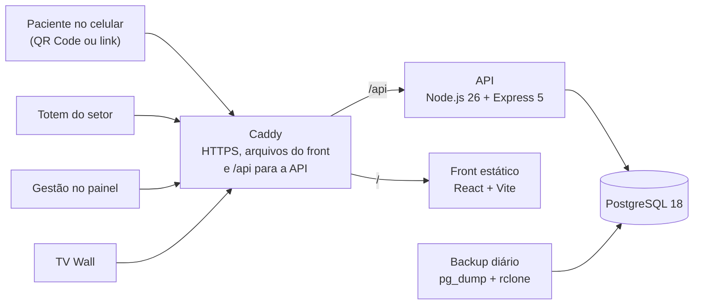
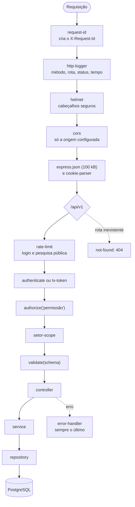

# Arquitetura do backend

Como a API do Sistema de Satisfação Hospitalar é organizada, os padrões de projeto que ela usa e por quê, sob três pontos de vista: **qualidade e manutenibilidade**, **segurança** e **escalabilidade**. As decisões vêm do [Plano de Desenvolvimento](Plano%20de%20Desenvolvimento%20-%20FHDOD.md) ("Visão geral da arquitetura", "Backend: camadas, middlewares e padrões" e "Autenticação, perfis e permissões"). As regras do dia a dia ficam no [`AGENTS.md`](../AGENTS.md).

## 1. Visão geral



- **Um monólito modular:** uma API REST em TypeScript, dividida em módulos por assunto, e um front estático, no mesmo domínio HTTPS.
- **Só a API acessa o banco.** O PostgreSQL não tem porta aberta para fora; toda regra e toda permissão passam pelo backend.
- **O contrato é o OpenAPI.** Os schemas Zod que validam as requisições geram o `openapi.json`, e o front gera os seus tipos a partir dele. Se a API muda um campo, o front deixa de compilar, em vez de quebrar em produção.

| Decisão | Escolha | Por quê |
| --- | --- | --- |
| Estilo | Monólito modular | Com 2 pessoas e um mês, microsserviços trariam vários deploys, rede e dados distribuídos sem ganho. Módulos isolados permitem extrair um serviço no futuro |
| Comunicação | REST com JSON, versionada em `/api/v1` | Simples de documentar e de integrar, inclusive com o WhatsApp na fase 3 |
| Domínio | Front e API no mesmo domínio (`/` e `/api`) | Sem CORS em produção, cookie de sessão `SameSite=Strict`, um certificado |
| Entrada | Caddy como proxy reverso | Emite e renova o HTTPS sozinho e serve o front |
| Contrato | `openapi.json` gerado e versionado | Mudança de contrato aparece no diff do PR, e o CI falha se o arquivo não bater com o código |
| Tarefas demoradas | Na própria requisição (MVP) | Volume baixo; na fase 2, um worker lê uma fila no PostgreSQL |
| "Tempo real" | Consulta a cada 60 s no painel e 30 s na TV | Indicadores de satisfação não mudam a cada segundo; SSE fica para a fase 3 |

## 2. Organização do código

| Pasta | O que tem |
| --- | --- |
| [`src/server.ts`](../src/server.ts) | Sobe o servidor HTTP e encerra com calma ao receber o sinal de parada |
| [`src/app.ts`](../src/app.ts) | `createApp()`, que monta a cadeia de middlewares |
| [`src/routes.ts`](../src/routes.ts) | Junta os roteadores dos módulos em `/api/v1` |
| [`src/config/`](../src/config/) | `env.ts` (variáveis validadas com Zod ao iniciar), `logger.ts` (pino), `openapi.ts` (o documento OpenAPI) |
| [`src/middlewares/`](../src/middlewares/) | `request-id`, `http-logger`, `rate-limit`, `authenticate`, `tv-token`, `authorize`, `setor-scope`, `validate`, `not-found`, `error-handler` |
| [`src/modules/`](../src/modules/) | 14 módulos: `auth`, `categorias`, `contatos`, `dashboard`, `docs`, `exportacao`, `health`, `perguntas`, `pesquisa`, `respostas`, `setores`, `turnos`, `tv-wall`, `usuarios` |
| [`src/shared/`](../src/shared/) | `constants/` (perfis, permissões, configurações), `errors/` (`AppError`), `http/` (paginação, filtros, download), `rules/` (NPS, classificação, médias, ranking, calendário), `security/` (cifra, senha, tokens, escopo) |
| [`src/database/`](../src/database/) | O cliente Prisma único e os auxiliares de banco |
| `src/generated/prisma/` | Cliente gerado pelo Prisma; não se edita |

**Cada módulo tem os mesmos arquivos:**

| Arquivo | Faz | Não faz |
| --- | --- | --- |
| `<modulo>.routes.ts` | Liga método e URL aos middlewares e ao controller | Nenhuma lógica |
| `<modulo>.controller.ts` | Lê os dados já validados, chama o service e devolve status e JSON | Regra de negócio ou acesso ao banco |
| `<modulo>.service.ts` | Regras de negócio, transações e auditoria | Conhecer `req` e `res` |
| `<modulo>.repository.ts` | Consultas do Prisma e o SQL dos relatórios | Decidir regras |
| `<modulo>.schemas.ts` | Schemas Zod de entrada e saída | — |
| `<modulo>.docs.ts` | Registro das rotas no OpenAPI, com os mesmos schemas | — |

## 3. Ciclo de uma requisição



Cada rota declara os próprios middlewares, nesta ordem. Lendo a rota, dá para saber quem pode chamá-la e o que é validado. Exemplo real, de [`perguntas.routes.ts`](../src/modules/perguntas/perguntas.routes.ts):

```ts
router.post(
  '/setores/:setorId/perguntas',
  authenticate,
  authorize('perguntas:gerenciar'),
  setorScope('setorId'),
  validate(criarPergunta),
  perguntasController.criar,
)
```

No Express 5, um erro lançado numa função `async` chega sozinho ao `error-handler`, então os controllers não têm `try/catch`. O `GET /api/health` fica fora do `/api/v1` e o Swagger, em `/api/docs`, só existe com `DOCS_ENABLED`.

**Respostas e erros num formato só.** Sucesso devolve `{ "data": ... }` (listas também `"meta": { pagina, porPagina, total }`). Erro devolve sempre `{ "erro": { codigo, mensagem, detalhes, requestId } }`, com os status 400, 401, 403, 404, 409, 429 e 500 da tabela "Respostas e erros" do plano. O `requestId` liga a mensagem que a pessoa viu à linha exata do log.

## 4. Padrões de projeto

| Padrão | Onde está | Problema que resolve | Ponto de vista |
| --- | --- | --- | --- |
| **Arquitetura em camadas** (Controller → Service → Repository) | Todo módulo | A regra fica testável sem HTTP e sem banco, e o mesmo service atende outro canal (o WhatsApp, na fase 3) | Manutenibilidade, escala |
| **Repository** | `src/modules/*/*.repository.ts` (13) | Isola o Prisma e o SQL; trocar uma consulta não mexe na regra | Manutenibilidade |
| **Service Layer** | `*.service.ts` | Regras, transações e auditoria num lugar só | Manutenibilidade |
| **Cadeia de responsabilidade** (middlewares) | `src/middlewares/`, ordem em `createApp()` | Autenticação, autorização, escopo e validação compostos rota a rota, cada um podendo encerrar a requisição | Segurança, legibilidade |
| **Factory** | `createApp()` em [`src/app.ts`](../src/app.ts); `criarAuthRoutes()`, `criarPesquisaRoutes()`, `criarLimiteDeLogin()` | Cada chamada monta uma aplicação (ou um limite) nova e independente: os testes criam a sua com o Supertest, com o contador de tentativas zerado | Testabilidade |
| **Singleton de módulo** | [`src/database/prisma.ts`](../src/database/prisma.ts), [`src/config/logger.ts`](../src/config/logger.ts) | Um cliente e um pool de conexões para a API inteira; um logger só | Desempenho |
| **Schema como fonte única** (validação + documentação) | `*.schemas.ts`, `validate.ts`, `*.docs.ts`, `openapi.json` | O schema que valida é o que documenta: a documentação não fica desatualizada, e o front recebe os tipos | Segurança, manutenibilidade |
| **Tratamento centralizado de erros** | `AppError` ([`app-error.ts`](../src/shared/errors/app-error.ts)), [`error-handler.ts`](../src/middlewares/error-handler.ts), `traduzirErroDoPrisma` | Um formato de erro; detalhe interno nunca vaza (500 com mensagem genérica, detalhe só no log) | Segurança |
| **Chave de idempotência** | `respostas.chave_idempotencia`, `pesquisa.service.ts` | Clique duplo ou rede instável não duplicam a avaliação | Confiabilidade |
| **Token de uso único com expiração** | Complemento da pesquisa, `pesquisaRepository.complementar` | Só quem acabou de responder anexa comentário e telefone, uma vez, em 30 minutos | Segurança |
| **Access token + refresh token rotativo** | Módulo `auth`, [`tokens.ts`](../src/shared/security/tokens.ts) | Sessão curta e revogável, sem guardar o token no banco (só o hash) | Segurança |
| **Configuração validada ao iniciar** (fail-fast) | [`src/config/env.ts`](../src/config/env.ts) | Sem uma variável, a API nem sobe: o erro aparece na hora, não em produção | Confiabilidade |
| **Regras puras** | [`src/shared/rules/`](../src/shared/rules/) | NPS, classificação e médias sem dependência de banco ou HTTP, cada uma com teste unitário | Manutenibilidade |
| **Outbox** (planejado) | Tabela `notificacoes` e worker, fase 2 | E-mails sem perda mesmo se o servidor de e-mail cair, sem Redis | Escala |

## 5. Qualidade e manutenibilidade

- **TypeScript em modo `strict`**, ESLint (typescript-eslint) e Prettier, com `.editorconfig` e `.nvmrc`.
- **Antes de cada commit**, o Husky roda o lint-staged (ESLint e Prettier nos arquivos alterados) e o commitlint (Conventional Commits, sem coautoria de ferramenta).
- **CI em todo PR** ([`.github/workflows/ci.yml`](../.github/workflows/ci.yml)): lint, tipos, testes (com PostgreSQL 18 no GitHub Actions), conferência do `openapi.json` e build.
- **635 testes em 55 arquivos**, com 98% das instruções e 93% das ramificações cobertas: o [plano e relatório de testes](plano-e-relatorio-de-testes.md) tem os detalhes.
- **Contrato conferido por teste:** `tests/contrato.test.ts` falha se uma rota não estiver documentada, se o documento tiver uma rota que não existe ou se o `openapi.json` não for o que o código gera.
- **Uma regra num lugar só:** a classificação da nota e o NPS ficam só na API (`src/shared/rules/`), e o front recebe o resultado pronto.
- **Cada entrega registrada** em `docs/registros/`, com as decisões e o que mudou em relação ao plano; o fluxo de trabalho está em [`padroes-git.md`](padroes-git.md).

O plano previa registros curtos de decisão (ADRs) em `docs/adr/`. Eles não foram criados: cada decisão está no plano, com o motivo, e nos registros de cada entrega, na tabela "Decisões e por quê".

## 6. Segurança

### 6.1 Autenticação

| Credencial | Onde fica | Validade | Por quê |
| --- | --- | --- | --- |
| Token de acesso (JWT) | Memória do navegador, enviado em `Authorization: Bearer` | 15 min | Se vazar, expira logo; leva só o ID do usuário |
| Refresh token | Cookie `HttpOnly`, `Secure` e `SameSite=Strict`, só em `/api/v1/auth`; no banco, só o hash SHA-256 | 7 dias, trocado a cada uso | O JavaScript não lê o cookie, e o banco permite revogar na hora |
| Token da TV | No link da tela, depois do `#` (nunca chega aos logs); no banco, só o hash | Até a tela ser desativada | A TV não tem quem digite senha e só lê números agregados |
| Token do complemento | Devolvido no envio da pesquisa; no banco, só o hash | 30 min, uso único | Só quem acabou de responder anexa comentário e telefone |

- Senhas com **argon2id** (`@node-rs/argon2`), mínimo de 10 caracteres com letras e números; a conta nasce com senha provisória e troca obrigatória.
- **Logout, desativação da conta e troca de senha revogam todas as sessões** da pessoa.
- O perfil e os setores **não ficam no token**: a cada requisição, o `authenticate` os lê do banco. Uma mudança feita pelo Super Admin vale na hora, e uma conta desativada recebe 401.

### 6.2 Autorização e proteção de rotas

- **Permissões por perfil** num mapa só, em [`src/shared/constants/permissoes.ts`](../src/shared/constants/permissoes.ts). Cada rota exige uma permissão com `authorize('...')`; sem ela, 403.

| Permissão | Super Admin | Gestor | Ouvidoria | Visualizador |
| --- | --- | --- | --- | --- |
| `setores`, `usuarios`, `categorias`, `turnos`, `tvwall:gerenciar` | ✓ | | | |
| `perguntas:gerenciar` | ✓ | ✓ nos seus setores | | |
| `dashboard:ver`, `exportacao:resumo` | ✓ | ✓ nos seus setores | ✓ | ✓ nos seus setores |
| `respostas:ver`, `comentarios:ver`, `exportacao:detalhada` | ✓ | ✓ nos seus setores | ✓ | |
| `contatos:ver` (telefones) | ✓ | | ✓ | |

- **Escopo de setor em três camadas:** o `setorScope` barra o setor da rota ou do filtro; o service confere o setor de um registro buscado pelo ID (`podeAcessarSetor`); e as listagens aplicam o escopo **dentro da consulta**, então um gestor nunca recebe dados de outro setor, mesmo pedindo "todos".
- **Limite de tentativas** ([`rate-limit.ts`](../src/middlewares/rate-limit.ts)): login com 5 erros em 15 minutos por IP e e-mail; pesquisa pública com 30 envios em 15 minutos por IP, com o IP do hospital (por onde saem os totens) fora do limite. Passou, 429.
- **Campo isca** invisível na pesquisa: um robô que o preenche é recusado.
- O front esconde menus sem permissão, mas **quem decide é sempre a API**.

### 6.3 Validação e sanitização da entrada

- Todo `body`, `query` e `params` passa por um schema Zod no middleware `validate`; o que não está no schema não chega ao controller.
- Corpo limitado a 100 kB (`express.json`).
- **SQL sempre parametrizado:** Prisma ou `$queryRaw` em template, com os valores separados do texto do SQL, nunca concatenados ([`mapeamento-classes-e-consultas.md`](mapeamento-classes-e-consultas.md), seção 6).
- O front é React, que escapa o texto ao exibir: um comentário com HTML aparece como texto, não vira código na tela.

### 6.4 Dados e transporte

| Medida | Onde |
| --- | --- |
| Telefone cifrado com AES-256-GCM, mascarado nas telas, revelado só com `contatos:ver` e sempre auditado | [`crypto.ts`](../src/shared/security/crypto.ts), módulo `contatos` |
| Logs sem dados sensíveis: `authorization`, `cookie`, tokens, senhas e `telefone` são trocados por `[oculto]` em qualquer nível do objeto | [`src/config/logger.ts`](../src/config/logger.ts) |
| Auditoria de login, troca e redefinição de senha, criação e mudança de usuários e perguntas, exportações e telefones revelados | [`src/database/auditoria.ts`](../src/database/auditoria.ts), tabela `auditoria` |
| HTTPS no Caddy; `helmet` com os cabeçalhos de segurança; `x-powered-by` desligado; CORS só para a origem configurada | Infra, [`src/app.ts`](../src/app.ts) |
| TV sem dados pessoais: o endpoint da TV nem devolve comentários | Módulo `tv-wall` |
| IP do paciente nunca gravado | Modelo de dados |

### 6.5 Onde cada medida é testada

| Medida | Testes |
| --- | --- |
| Login, refresh rotativo, logout, sessão revogada, limite de tentativas | `tests/integration/auth.test.ts`, `src/shared/security/tokens.test.ts`, `password.test.ts` |
| Permissão por perfil e escopo de setor (401, 403, listas sem outro setor) | `tests/integration/permissoes.test.ts`, `src/shared/constants/permissoes.test.ts` e o teste de cada módulo |
| Cadeia de middlewares, formato do erro, 404, corpo grande | `tests/integration/middlewares.test.ts`, `respostas-e-erros.test.ts` |
| Limite de envios, isca, idempotência, token do complemento | `tests/integration/pesquisa.test.ts`, `pesquisa-geral.test.ts`, `complemento.test.ts` |
| Cifra do telefone e revelação auditada | `src/shared/security/crypto.test.ts`, `tests/integration/contatos.test.ts` |
| Entrada maliciosa tratada como dado | `tests/integration/injecao.test.ts` |

## 7. Escalabilidade e expansão

**O que já ajuda a crescer:**

- **API sem sessão no servidor:** o token de acesso é validado sem consultar sessões, e o perfil vem do banco.
- **Agregações no banco**, com índices nos filtros do painel: a API recebe só os números, não as linhas.
- **Exportação em lotes** de 500 respostas, então a memória não cresce com o período.
- **API versionada** (`/api/v1`): uma mudança incompatível vira `/api/v2` sem derrubar quem usa a primeira.
- **Canal em cada resposta** (`WEB`, `TOTEM`, `WHATSAPP`): os relatórios separam os canais, e o WhatsApp entra sem migrar dados.
- **Módulos isolados:** um módulo pode virar serviço próprio, porque só conversa com os outros pelos services.
- **Docker em qualquer lugar:** a mesma imagem roda numa VPS, no servidor do hospital ou numa plataforma gerenciada, e o banco pode sair do servidor ([`infra/docker-compose.banco-externo.yml`](../infra/docker-compose.banco-externo.yml)).

**Limites atuais, conhecidos e aceitos para o MVP:**

| Limite | Por quê hoje | Quando e como mudar |
| --- | --- | --- |
| O limite de tentativas conta na memória do processo | A API roda num processo só | Com mais de uma instância, o contador vai para um lugar comum, como o banco |
| Uma instalação atende um hospital (não há `tenant_id`) | Um cliente, dados isolados por instalação | Para vários hospitais numa instalação só, cada tabela ganha o hospital e as consultas, o filtro dele |
| Exportações geradas na própria requisição | Volume baixo | Uma fila de geração, como a dos e-mails da fase 2 |
| Painel e TV por consulta periódica | Indicadores mudam devagar | SSE (fase 3), avisando quando chega uma resposta |

**Próximos módulos, já previstos no plano:** `ouvidoria/`, `notificacoes/` e `escalas/`, com `src/worker.ts` (fase 2); `integracoes/whatsapp/` (fase 3).

## 8. Configuração e ambientes

- [`src/config/env.ts`](../src/config/env.ts) valida as variáveis com Zod ao iniciar; o [`.env.example`](../.env.example) documenta todas, sem valores reais, e o `.env` nunca vai para o Git.
- **Desenvolvimento:** a máquina de cada pessoa, com o PostgreSQL do `docker-compose.yml`.
- **Homologação e produção:** o mesmo `infra/docker-compose.prod.yml`, com o `infra/.env` de cada servidor. A imagem aplica as migrations e o seed base ao iniciar.
- **Swagger** ligado em desenvolvimento e homologação, desligado em produção (`DOCS_ENABLED`).

## 9. Observabilidade

- Logs em JSON (pino), uma linha por requisição, com `requestId`, rota, status e duração, sem dados sensíveis.
- `GET /api/health` testa a conexão com o banco; é o healthcheck do Docker e o endereço do monitor externo previsto para a homologação (ticket 20).

## 10. Decisões e alternativas descartadas

| Decisão | Alternativa | Por que não |
| --- | --- | --- |
| Monólito modular | Microsserviços | Mais deploys, rede e dados distribuídos para 2 pessoas e um mês |
| REST | GraphQL | Telas conhecidas e poucas consultas; REST é mais simples de documentar e integrar |
| JWT + refresh rotativo | Sessão guardada no servidor | Também funcionaria; o JWT atende integrações futuras sem cookie |
| Login próprio | Provedor externo (Auth0, Keycloak) | Custo e dependência sem ganho para um grupo pequeno de usuários internos |
| PostgreSQL | MySQL, MongoDB | [`modelo-de-dados-e-requisitos.md`](modelo-de-dados-e-requisitos.md), seção 2 |
| Consulta periódica | WebSocket | A comunicação é só do servidor para a tela; SSE basta, na fase 3 |
| Exportação no backend | Gerar no navegador | O navegador não precisa baixar milhares de linhas, e a permissão não pode depender do front |
| Dois repositórios ligados pelo `openapi.json` | Monorepo | Exigência da disciplina; o contrato versionado cobre o que um pacote compartilhado faria |
