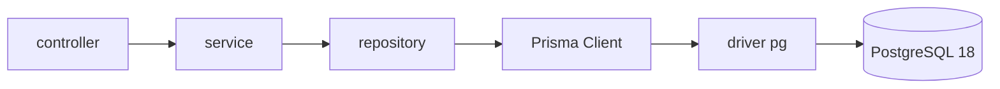

# Classes de persistência e principais consultas

Que código da API fala com o banco, o que cada parte lê e grava, e as consultas que mais pesam no sistema. O modelo está em [`modelo-de-dados-e-requisitos.md`](modelo-de-dados-e-requisitos.md), e as convenções das consultas, em [`padroes-banco-de-dados.md`](padroes-banco-de-dados.md), seção 8.

## 1. Como a API chega ao banco



- **Só o repository fala com o banco.** O controller lê a requisição já validada e chama o service; o service tem as regras e chama o repository. Nenhum controller ou service importa o Prisma para consultar (a regra das camadas, no [`AGENTS.md`](../AGENTS.md)).
- **Um cliente para a API inteira:** [`src/database/prisma.ts`](../src/database/prisma.ts) cria um único `PrismaClient`, com o adaptador `PrismaPg` (driver `pg`). Todos os repositórios usam essa instância e o mesmo pool de conexões. Sem banco, a conexão desiste em 5 segundos, em vez de deixar a requisição esperando.
- **Conexão:** a `DATABASE_URL`, validada em [`src/config/env.ts`](../src/config/env.ts) ao iniciar. Sem ela, a API nem sobe.
- **Código gerado:** `pnpm db:generate` (e o `postinstall`) gera em `src/generated/prisma/` o cliente e um model tipado por tabela. A pasta nunca é editada à mão.

## 2. Models gerados

| Model (código) | Tabela | Repositórios que usam |
| --- | --- | --- |
| `Usuario` | `usuarios` | auth, usuarios (e o `UPDATE` do último login) |
| `UsuarioSetor` | `usuario_setores` | usuarios (leitura também pelo auth) |
| `RefreshToken` | `refresh_tokens` | auth, usuarios |
| `Setor` | `setores` | setores, pesquisa, perguntas, usuarios, auth, exportacao; nas junções do SQL dos relatórios |
| `Categoria` | `categorias` | categorias, perguntas; nas junções do SQL |
| `Turno` | `turnos` | turnos, pesquisa, exportacao; nas junções do SQL |
| `Pergunta` | `perguntas` | perguntas, pesquisa |
| `Resposta` | `respostas` | pesquisa, respostas; SQL do dashboard, da exportação e dos contatos |
| `RespostaItem` | `resposta_itens` | pesquisa (grava), perguntas (confere se há respostas); SQL do dashboard e da exportação |
| `Comentario` | `comentarios` | pesquisa (grava); SQL do dashboard, das respostas, da exportação e dos contatos |
| `ContatoRetorno` | `contatos_retorno` | pesquisa (grava), contatos; SQL das respostas e da exportação |
| `TvTela` | `tv_telas` | tv-wall |
| `Configuracao` | `configuracoes` | `src/database/configuracoes.ts` |
| `Auditoria` | `auditoria` | auth, perguntas, usuarios, contatos, exportacao, `src/database/auditoria.ts` |

## 3. Repositórios

Um por módulo, em `src/modules/<modulo>/<modulo>.repository.ts`, cada um um objeto com as funções de acesso (`setoresRepository.listar`, `pesquisaRepository.criar`...). As contagens abaixo foram tiradas do código.

| Repositório | Funções | Operações do Prisma | SQL puro | Transação |
| --- | --- | --- | --- | --- |
| [auth](../src/modules/auth/auth.repository.ts) | `buscarParaLogin`, `buscarParaAutenticar`, `buscarSenhaHash`, `buscarSetores`, `registrarLogin`, `buscarRefresh`, `trocarRefresh`, `revogarSessoes`, `trocarSenha` | `usuario` (find, update), `refreshToken` (create, find, update, updateMany), `setor.findMany`, `auditoria.create` | `UPDATE usuarios SET ultimo_login_em` | Login (sessão + último login + auditoria), troca do refresh, troca de senha |
| [categorias](../src/modules/categorias/categorias.repository.ts) | `listar`, `criar`, `editar` | `categoria` (findMany, aggregate da maior ordem, create, update) | — | — |
| [contatos](../src/modules/contatos/contatos.repository.ts) | `listar`, `buscarTelefone`, `registrarRevelacao` | `contatoRetorno.findUnique`, `auditoria.create` | Lista dos pedidos e total | Lista + total |
| [dashboard](../src/modules/dashboard/dashboard.repository.ts) | `resumo`, `npsPorSetor`, `evolucao`, `categorias`, `notasPorPonto`, `comentarios` | — | Todas as 7 consultas (só leitura) | Comentários + total |
| [exportacao](../src/modules/exportacao/exportacao.repository.ts) | `respostasDoArquivo`, `respostas`, `itens`, `comentarios`, `nomeDoSetor`, `nomeDoTurno`, `setores`, `registrarExportacao` | `setor` (find), `turno.findUnique`, `auditoria.create` | As respostas, os itens e os comentários do arquivo | — |
| [health](../src/modules/health/health.repository.ts) | `consultarBanco` | — | `SELECT 1` | — |
| [perguntas](../src/modules/perguntas/perguntas.repository.ts) | `setorExiste`, `buscarCategoria`, `listar`, `buscar`, `criar`, `editar`, `posicoes`, `ordenar`, `alterarStatus` | `pergunta` (find, aggregate, create, update), `respostaItem.findFirst`, `setor.count`, `categoria.findUnique`, `auditoria.create` | — | Mudança + auditoria; nova ordem do setor |
| [pesquisa](../src/modules/pesquisa/pesquisa.repository.ts) | `buscarSetor`, `perguntasAtivas`, `setoresAtivosComPerguntas`, `buscarSetores`, `perguntasAtivasDosSetores`, `turnos`, `turnoExiste`, `buscarPorChave`, `buscarPorChaves`, `criar`, `criarVarias`, `trocarTokens`, `trocarToken`, `complementar` | `setor`, `pergunta`, `turno` (leitura); `resposta` (create com os itens, find, updateMany); `comentario.create`, `contatoRetorno.create` | — | Envio de vários setores; troca dos tokens; complemento |
| [respostas](../src/modules/respostas/respostas.repository.ts) | `listar`, `buscar`, `partesDoDetalhe` | `resposta.findUnique` (itens, comentário e pedido, sem o telefone cifrado) | Lista, total e resumo de uma resposta | Lista + total |
| [setores](../src/modules/setores/setores.repository.ts) | `listar`, `criar`, `editar`, `alterarStatus` | `setor` (findMany, create, update, updateMany) | — | — |
| [turnos](../src/modules/turnos/turnos.repository.ts) | `listar`, `criar`, `editar` | `turno` (findMany, aggregate, create, update) | — | — |
| [tv-wall](../src/modules/tv-wall/tv-wall.repository.ts) | `listar`, `criar`, `alterarStatus`, `buscarPeloToken`, `registrarAcesso` | `tvTela` (findMany, create, updateMany, findUnique) | `UPDATE tv_telas SET ultimo_acesso_em` | — |
| [usuarios](../src/modules/usuarios/usuarios.repository.ts) | `listar`, `buscar`, `criar`, `editar`, `setoresExistem`, `definirSetores`, `alterarStatus`, `redefinirSenha` | `usuario` (find, create, update), `usuarioSetor` (createMany, deleteMany), `refreshToken.updateMany`, `setor.count`, `auditoria.create` | — | Mudança + auditoria; setores trocados juntos; desativação ou nova senha + revogação das sessões |

- **Os dois `UPDATE` em SQL** (último login e último acesso da TV) existem para não mexer no `atualizado_em`, que o Prisma atualiza sozinho em todo `update` e que marca a última mudança no **cadastro**, não o acesso.
- **Os indicadores da TV** não têm consulta própria: o `tv-wall.service` chama o `dashboardService`, então a TV usa as mesmas consultas do dashboard.

## 4. Auxiliares em `src/database/`

| Arquivo | Papel |
| --- | --- |
| [`prisma.ts`](../src/database/prisma.ts) | O cliente único (seção 1) |
| [`filtros-do-painel.ts`](../src/database/filtros-do-painel.ts) | `condicoesDoPainel`: o `WHERE` dos filtros (período, base da data, setor, turno, canal) e do escopo de setor, todo em parâmetros. `diaDaResposta`: o dia do atendimento ou o do envio em Brasília. Usado pelo dashboard, pelas respostas, pelos contatos e pela exportação |
| [`configuracoes.ts`](../src/database/configuracoes.ts) | `lerConfiguracoes`: lê a tabela `configuracoes` e cai no padrão de `CONFIGURACOES_PADRAO` quando falta uma chave ou o tipo está errado |
| [`auditoria.ts`](../src/database/auditoria.ts) | Monta a linha da auditoria (quem, o quê, qual registro, IP) |
| [`erros.ts`](../src/database/erros.ts) | `traduzirErroDoPrisma`: `P2002` (valor repetido) vira 409 `CONFLITO` e `P2025` (registro inexistente) vira 404 `NAO_ENCONTRADO`; qualquer outro erro passa e vira 500 |

## 5. Principais consultas

As mais **frequentes** são as da pesquisa (a cada paciente) e as do painel e da TV, refeitas a cada 60 s no dashboard e a cada 30 s na TV. As mais **críticas** são a gravação da avaliação (integridade) e a evolução (a mais complexa).

### 5.1 Painel (dashboard e TV)

Todas leem `respostas r` com o `condicoesDoPainel` e respeitam o escopo de setor de quem pede.

| ID | Consulta | Função | Rota | Junções | Filtros | Agregações | Índice que atende |
| --- | --- | --- | --- | --- | --- | --- | --- |
| Q01 | Resumo | `dashboardRepository.resumo` | `GET /dashboard/resumo`, TV | `resposta_itens` (numa CTE) | Painel | `count(*) FILTER` para promotores, neutros, detratores, notas baixas e baixíssimas; `count` e `sum` das notas | `respostas (data_atendimento)` ou `(setor_id, enviado_em)`; único `(resposta_id, pergunta_id)` nos itens |
| Q02 | NPS por setor | `npsPorSetor` | `GET /dashboard/nps-por-setor`, TV | `setores` | Painel | `count FILTER` por setor (`GROUP BY`) | O mesmo de Q01 |
| Q03 | Evolução | `evolucao` | `GET /dashboard/evolucao`, TV | `generate_series` `LEFT JOIN` respostas | Painel + granularidade | `date_trunc` por dia, semana ou mês; contagens do NPS por período, inclusive os vazios | O mesmo de Q01 |
| Q04 | Notas por categoria | `categorias` | `GET /dashboard/categorias` | `resposta_itens`, `categorias`, `setores` | Painel + só itens de escala com nota | `count`, `sum` e notas 4 e 5 por categoria | `resposta_itens (categoria_id)` |
| Q05 | Notas por ponto (setor × categoria) | `notasPorPonto` | `GET /dashboard/ranking`, destaques da TV | As de Q04 | Painel | O mesmo de Q04, por setor e categoria | O mesmo de Q04 |
| Q06 | Comentários recentes + total | `comentarios` | `GET /dashboard/comentarios` | `respostas`, `setores` | Painel + tipo do comentário | `count(*)` do total | Únicos de `comentarios.resposta_id` |

**Q03, a evolução por período**, é a que melhor mostra o porquê do PostgreSQL. A série de períodos vem do `generate_series`, e as respostas entram por `LEFT JOIN`, então uma semana sem nenhuma avaliação aparece com total 0, em vez de sumir do gráfico:

```sql
WITH periodos AS (
  SELECT generate_series(
           date_trunc($unidade, $inicio::date::timestamp),
           $fim::date::timestamp,
           $passo::interval
         ) AS inicio
),
filtradas AS (
  SELECT r.id, r.nps, date_trunc($unidade, <dia da resposta>::timestamp) AS periodo
  FROM respostas r
  WHERE <condicoesDoPainel>
)
SELECT to_char(p.inicio, 'YYYY-MM-DD') AS periodo,
       count(r.id)::int AS total,
       (count(r.id) FILTER (WHERE r.nps >= 9))::int AS promotores,
       (count(r.id) FILTER (WHERE r.nps <= 6))::int AS detratores
FROM periodos p
LEFT JOIN filtradas r ON r.periodo = p.inicio
GROUP BY p.inicio
ORDER BY p.inicio;
```

O `<dia da resposta>` é `r.data_atendimento` ou, com a base do envio, `(r.enviado_em AT TIME ZONE 'America/Sao_Paulo')::date`: o instante gravado em UTC volta para o dia de Brasília. Com a base do envio, o filtro do período vira um intervalo de instantes (da meia-noite do início à meia-noite depois do fim, em Brasília), e não uma conversão linha a linha, para o índice `(setor_id, enviado_em)` continuar valendo. O 9 e o 6 vêm das constantes `PROMOTOR_A_PARTIR_DE` e `DETRATOR_ATE`, passadas como parâmetros.

**Q01, o resumo**, faz todas as contagens numa passada só, com `FILTER`:

```sql
WITH filtradas AS (
  SELECT r.id, r.nps, r.classificacao FROM respostas r WHERE <condicoesDoPainel>
),
notas AS (
  SELECT count(i.valor_numero)::int AS quantidade, coalesce(sum(i.valor_numero), 0)::int AS soma
  FROM resposta_itens i JOIN filtradas f ON f.id = i.resposta_id
  WHERE i.tipo = 'ESCALA_1_5'
)
SELECT count(r.id)::int AS total,
       (count(r.id) FILTER (WHERE r.nps >= 9))::int AS promotores,
       (count(r.id) FILTER (WHERE r.nps <= 6))::int AS detratores,
       (count(r.id) FILTER (WHERE r.nps > 6 AND r.nps < 9))::int AS neutros,
       (count(r.id) FILTER (WHERE r.classificacao IN ('BAIXA', 'BAIXISSIMA')))::int AS "notasBaixas",
       (count(r.id) FILTER (WHERE r.classificacao = 'BAIXISSIMA'))::int AS baixissimas,
       n.quantidade AS "quantidadeDeNotas", n.soma AS "somaDasNotas"
FROM notas n LEFT JOIN filtradas r ON TRUE
GROUP BY n.quantidade, n.soma;
```

O NPS e a média não saem do banco: o banco só conta, e o service calcula com as regras de `src/shared/rules/` (`calcular-nps.ts`, `media.ts`), que têm testes unitários próprios.

### 5.2 Listas do painel

| ID | Consulta | Função | Rota | Junções | Filtros | Ordem e paginação |
| --- | --- | --- | --- | --- | --- | --- |
| Q07 | Lista de respostas + total | `respostasRepository.listar` | `GET /respostas` | `setores`, `turnos`, `LEFT JOIN comentarios` e `contatos_retorno` | Painel + classificação, com comentário, com pedido de retorno | Coluna e sentido pedidos, desempate pelo ID; `LIMIT`/`OFFSET`; o total na mesma transação |
| Q08 | Detalhe de uma resposta | `buscar` + `partesDoDetalhe` | `GET /respostas/:id` | As de Q07; depois itens, comentário e pedido pelo Prisma | O ID | Itens na ordem em que foram gravados (a que o paciente viu) |
| Q09 | Pedidos de retorno + total | `contatosRepository.listar` | `GET /contatos` | `respostas`, `setores`, `LEFT JOIN comentarios` | Painel | Do consentimento mais recente; `LIMIT`/`OFFSET`; total na mesma transação |
| Q10 | Telefone de um pedido | `buscarTelefone` | `POST /contatos/:id/revelar-telefone` | `respostas` (o setor, para o escopo) | O ID | A revelação vai para a auditoria |

Cada resposta tem no máximo um comentário e um pedido de retorno (as duas colunas `resposta_id` são únicas), então os `LEFT JOIN` de Q07 não repetem linhas. As listas só leem `telefone_final`; o `telefone_cifrado` sai do banco apenas em Q10 e na exportação detalhada de quem pode ver telefones.

### 5.3 Exportação

| ID | Consulta | Função | O que faz |
| --- | --- | --- | --- |
| Q11 | Respostas do arquivo | `exportacaoRepository.respostasDoArquivo` | Os IDs das respostas dos filtros, na ordem do arquivo. Só com a permissão de ver telefones a consulta faz o `LEFT JOIN contatos_retorno` e traz o telefone cifrado; sem ela, nem lê a tabela |
| Q12 | Lotes do arquivo | `respostas`, `itens`, `comentarios` | Os dados de um lote de IDs (`r.id = ANY($ids::int[])`), com `setores`, `turnos`, `categorias`, `comentarios` e `contatos_retorno` |

Primeiro vêm os IDs; depois, os dados em lotes de 500 respostas (`RESPOSTAS_POR_LOTE`), lidos só quando a aba da planilha pede o próximo. Assim a memória da API não cresce com o período exportado.

### 5.4 Pesquisa do paciente

| ID | Consulta | Função | Rota | O que faz |
| --- | --- | --- | --- | --- |
| Q13 | Abrir a pesquisa do setor | `buscarSetor`, `perguntasAtivas`, `turnos`, `lerConfiguracoes` | `GET /publico/setores/:slug/pesquisa` | O setor pelo slug (índice único), as perguntas ativas em ordem (`ordem`, depois `id`), os turnos e as configurações |
| Q14 | Abrir a pesquisa geral | `setoresAtivosComPerguntas` | `GET /publico/pesquisa` | Os setores ativos, cada um com as perguntas ativas, numa consulta do Prisma |
| Q15 | Gravar a avaliação | `criar` / `criarVarias` | `POST /publico/setores/:slug/respostas`, `POST /publico/respostas` | `INSERT` da resposta e dos itens juntos. Na pesquisa geral, uma avaliação por setor, numa transação: ou entra tudo, ou nada |
| Q16 | Reenvio | `buscarPorChave` / `buscarPorChaves` | As mesmas | Antes de gravar, a API procura a chave de idempotência (índice único); se ela já existe, devolve a avaliação gravada, com um token novo. Se dois envios iguais chegam ao mesmo tempo, o `INSERT` do segundo falha com `P2002`, e ele devolve a avaliação do primeiro |
| Q17 | Complemento | `complementar` | `POST /publico/respostas/:id/complemento` | Numa transação: um `UPDATE` que confere o hash e o prazo do token **e os apaga na mesma instrução**; só então grava o comentário e o pedido de retorno |

**Q17** resolve a concorrência no próprio banco. Se duas requisições chegam com o mesmo token ao mesmo tempo, o PostgreSQL faz a segunda esperar a primeira; quando a segunda roda, o token já não existe, e ela não grava nada:

```sql
UPDATE respostas
SET token_complemento_hash = NULL, token_complemento_expira_em = NULL
WHERE id = $id AND token_complemento_hash = $hash AND token_complemento_expira_em > $agora;
-- 0 linhas: o token não valia, e nada é gravado
```

### 5.5 Acesso e TV

| ID | Consulta | Função | O que faz |
| --- | --- | --- | --- |
| Q18 | Login | `authRepository.buscarParaLogin`, `registrarLogin` | A conta pelo e-mail (índice único); depois, numa transação, a sessão nova, o último login e a linha da auditoria |
| Q19 | Autenticar cada requisição | `buscarParaAutenticar` | A conta, o perfil e os setores a cada requisição: uma mudança feita pelo Super Admin vale na hora |
| Q20 | Token da TV | `tvWallRepository.buscarPeloToken`, `registrarAcesso` | A tela pelo hash do token (índice único); o último acesso só é gravado se mudou o bastante, numa condição do próprio `UPDATE` |
| Q21 | Saúde | `healthRepository.consultarBanco` | `SELECT 1`, chamado pelo `/api/health` (Docker e monitoramento) |

## 6. Segurança no acesso aos dados

- **Tudo parametrizado.** O Prisma e o `$queryRaw` em template mandam os valores separados do SQL (`$1`, `$2`...). Nenhuma consulta é montada com texto vindo da requisição, que já chega validada pelo Zod.
- **Escopo dentro da consulta.** Para o Gestor e o Visualizador, o `condicoesDoPainel` acrescenta `r.setor_id = ANY($setores::int[])` mesmo sem filtro de setor: um pedido de "todos" nunca devolve outro setor.
- **Dados sensíveis só onde precisam.** O telefone cifrado não sai nas listas (seção 5.2), e a TV recebe só números agregados.

Mais em [`seguranca-e-nuvem.md`](seguranca-e-nuvem.md).
