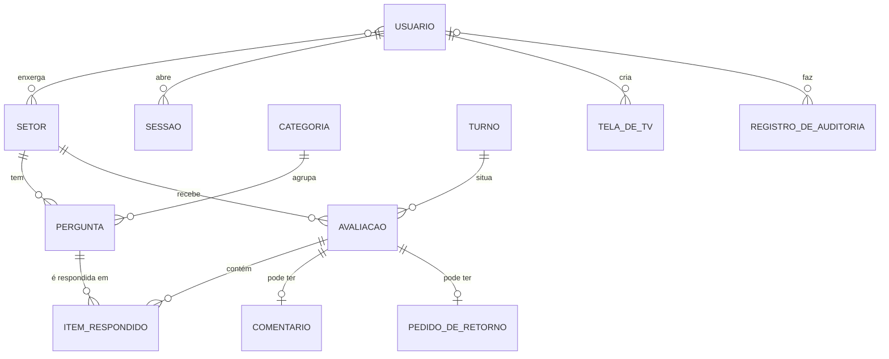
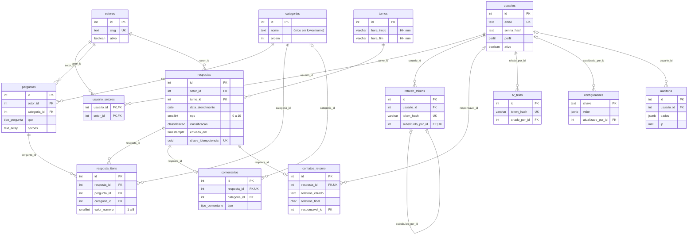

# Modelo de dados e escolha do paradigma

O que o Sistema de Satisfação Hospitalar guarda, por que num banco relacional e como as 14 tabelas do MVP se ligam. O modelo está em [`prisma/schema.prisma`](../prisma/schema.prisma), e o SQL que o cria, na migration [`20261121221631_modelo_de_dados_do_mvp`](../prisma/migrations/20261121221631_modelo_de_dados_do_mvp/migration.sql). As decisões vêm do [Plano de Desenvolvimento](Plano%20de%20Desenvolvimento%20-%20FHDOD.md), em "Modelo de dados (PostgreSQL)".

| Documento relacionado | Assunto |
| --- | --- |
| [`padroes-banco-de-dados.md`](padroes-banco-de-dados.md) | Nomes de tabelas, colunas, chaves, restrições e índices |
| [`mapeamento-classes-e-consultas.md`](mapeamento-classes-e-consultas.md) | Que código lê e grava cada tabela, e as consultas principais |
| [`seguranca-e-nuvem.md`](seguranca-e-nuvem.md) | Hospedagem, acesso, criptografia e backup |

## 1. Requisitos de dados

Cada necessidade vem do pedido do hospital ou de uma regra do plano, e cada uma vira uma decisão no modelo.

| Necessidade | De onde vem | Como o modelo atende |
| --- | --- | --- |
| Toda avaliação tem a nota de 0 a 10 | Uma única pergunta obrigatória (regra "Pergunta obrigatória") | `respostas.nps` `NOT NULL`, com `CHECK` de 0 a 10 |
| Notas de 1 a 5 comparáveis por setor e por categoria | Perguntas pela jornada do paciente | Uma linha por pergunta respondida em `resposta_itens`, com a categoria e a nota em colunas próprias e `CHECK` de 1 a 5 |
| Setores com perguntas diferentes, sem mudar o banco | Cada setor monta a sua pesquisa | Pergunta nova é uma linha em `perguntas`, ligada ao setor e a uma categoria |
| O histórico não muda de sentido | Gestores reescrevem perguntas | `resposta_itens` copia o texto, o tipo e a categoria da pergunta no momento da resposta |
| Saber o setor, o dia e o turno de cada avaliação | O papel não dizia setor, data nem turno | `setor_id`, `data_atendimento` e `turno_id` obrigatórios em `respostas` |
| Separar o dia do atendimento do instante do envio | A pessoa pode responder no dia seguinte | `data_atendimento` (`date`) e `enviado_em` (`timestamptz`) |
| Relatórios pelo dia de Brasília | Indicadores do painel | `enviado_em` em UTC, convertido na consulta com `AT TIME ZONE 'America/Sao_Paulo'` |
| Não gravar a mesma avaliação duas vezes | Clique duplo, rede instável no totem | `respostas.chave_idempotencia` única (`uuid`) |
| Comentário e telefone depois do envio, só por quem respondeu | O NPS grava a avaliação; o resto é complemento | Token de uso único: só o hash e o prazo, em `respostas` |
| Telefone opcional, com consentimento e acesso restrito | Retorno da Ouvidoria e LGPD | `contatos_retorno` com o telefone cifrado, os 4 últimos dígitos em claro e o instante do consentimento |
| Pesquisa anônima | LGPD, coleta mínima | Nenhuma coluna de nome, documento ou IP do paciente |
| Perfis e setores de cada pessoa do painel | Níveis de acesso por setor | `usuarios.perfil` e a tabela `usuario_setores` |
| Sessões revogáveis | Segurança do login | `refresh_tokens`, só com o hash, e a cadeia de substituição |
| Rastro de quem fez o quê | Segurança e LGPD | `auditoria`, com os detalhes em `jsonb` |
| Limites de nota e tempos do totem ajustáveis | Regras "Notas baixas" e "Totem" | `configuracoes`, uma linha por chave, com o valor em `jsonb` |
| Nada se perde quando um cadastro sai de uso | Histórico das respostas | Exclusão lógica (`ativo`/`ativa`) em setores, perguntas, categorias e usuários |

**Volume:** o de um hospital regional, com uma linha em `respostas` por avaliação e uma em `resposta_itens` por pergunta respondida. O volume real depende de quantas pessoas o hospital atende e de quantas respondem; ele ainda não foi informado e não muda as decisões abaixo.

## 2. Por que relacional, e não NoSQL

### 2.1 Comparação pelos critérios do sistema

| Critério | O que o FHDOD precisa | Banco relacional (PostgreSQL) | Banco de documentos (ex.: MongoDB) |
| --- | --- | --- | --- |
| Forma dos dados | Entidades estáveis e muito ligadas: setor → pergunta → item ← resposta → setor | Tabelas e chaves estrangeiras descrevem isso diretamente | As ligações viram documentos aninhados ou referências que o banco não confere |
| Integridade | Nota de 0 a 10 e de 1 a 5; item sempre de uma pergunta e uma resposta que existem; slug e e-mail únicos | `CHECK`, `FOREIGN KEY` e `UNIQUE` no próprio banco, valendo para qualquer código que grave | Validação de schema opcional; sem chave estrangeira, a integridade entre documentos fica toda no código |
| Consultas do painel | NPS por setor, evolução por dia, semana ou mês **incluindo os períodos sem resposta**, médias por categoria e setor | Uma consulta por indicador: `count(*) FILTER`, `generate_series`, `date_trunc`, `JOIN` | Pipelines de agregação; os períodos vazios e os cruzamentos pedem mais etapas |
| Transações | A avaliação, os itens e a classificação gravados juntos; na pesquisa geral, uma avaliação por setor, tudo ou nada | ACID, com várias tabelas numa transação | Transações com vários documentos existem, mas o modelo de documentos foi pensado para gravar um documento por vez |
| Flexibilidade | Cada setor com as suas perguntas | Pergunta nova é uma linha, sem coluna nova; o que muda de formato fica em `jsonb` | Esquema livre |
| Escala | O volume de um hospital (seção 1) | Sobra | Sobra |
| Ferramentas do time | Prisma, migrations versionadas, testes contra o banco real | Prisma com migrations em SQL, revisadas no PR | O Prisma também fala com o MongoDB, mas sem as migrations |
| Hospedagem gerenciada | Banco em nuvem, de preferência no Brasil | Supabase, Neon, AWS RDS e outros | MongoDB Atlas |

Escala e hospedagem empatam. Nos critérios que decidem (integridade, consultas do painel e transações), o relacional atende com o próprio banco o que, num banco de documentos, ficaria a cargo do código.

### 2.2 Como seria a avaliação como documento

O modelo de documentos guardaria cada avaliação num documento só:

```json
{
  "setor": "pronto-atendimento",
  "nps": 6,
  "itens": [
    { "pergunta": "Como foi o atendimento na recepção?", "categoria": "Recepção", "nota": 4 },
    { "pergunta": "Quanto tempo você esperou?", "categoria": "Tempo de Espera", "nota": 2 }
  ]
}
```

Gravar fica simples, mas o painel lê **as notas por categoria e por setor**, não avaliações inteiras. Cada média abriria todos os documentos do período, e as notas ficariam sem a chave estrangeira da pergunta e sem o limite de 1 a 5, justamente o que as médias usam. O plano registra essa decisão em "Respostas em linhas, não em JSONB".

### 2.3 Onde o modelo usa a ideia de documento

O PostgreSQL também guarda documentos, e o modelo usa isso onde o formato varia e nada entra nos cálculos:

| Coluna | Tipo | Por quê |
| --- | --- | --- |
| `configuracoes.valor` | `jsonb` | Cada configuração tem um tipo (número ou texto) |
| `auditoria.dados` | `jsonb` | Cada ação registra detalhes diferentes |
| `perguntas.opcoes` | `text[]` | Lista simples, só na múltipla escolha |

### 2.4 Por que PostgreSQL entre os relacionais

O plano começou com MySQL e passou para PostgreSQL antes de existir código ("Por que PostgreSQL", no plano). Neste volume os dois dão conta; o que pesou foi o SQL dos relatórios:

| Recurso | Onde o sistema usa |
| --- | --- |
| Agregação com `FILTER` | Promotores, neutros e detratores numa única consulta |
| `generate_series` e `date_trunc` | Evolução com os períodos sem resposta |
| `timestamptz` e `AT TIME ZONE` | Envio gravado em UTC, agrupado pelo dia de Brasília |
| Arrays | Opções das perguntas e o escopo de setores do usuário num parâmetro só (`= ANY(...)`) |
| `jsonb` | Configurações e auditoria |
| Índice único sobre expressão | Categorias sem nome repetido, mesmo com maiúsculas diferentes (`lower(nome)`) |

### 2.5 Conclusão

O banco é **relacional, em PostgreSQL 18**. Os dados do sistema são estruturados e ligados entre si. O valor do produto está nos cruzamentos (setor, categoria, turno e período), e as regras que não podem falhar (a nota obrigatória e os limites das notas) ficam garantidas no próprio banco. Onde o formato varia, o `jsonb` dá a flexibilidade de um documento sem trocar de banco.

## 3. Modelo conceitual

As entidades e como se relacionam, sem os atributos.



- Uma **pessoa do painel** enxerga vários **setores**, e um setor é visto por várias pessoas.
- Um **setor** tem várias **perguntas**, cada uma de uma **categoria** (Recepção, Triagem...).
- Uma **avaliação** é de um setor, num dia e num **turno**, e contém zero ou mais **itens respondidos**: todas as perguntas podem ser puladas.
- Uma avaliação tem no máximo um **comentário** e no máximo um **pedido de retorno**.
- **Configurações** não se ligam a outras entidades, a não ser a quem as alterou.

## 4. Modelo lógico

### 4.1 Diagrama

Chaves primárias (`PK`), estrangeiras (`FK`) e únicas (`UK`). Os tipos completos estão no dicionário (seção 5).



### 4.2 Relacionamentos e o que acontece ao apagar

| Chave estrangeira | Aponta para | Ao apagar o registro apontado | Por quê |
| --- | --- | --- | --- |
| `usuario_setores.usuario_id` | `usuarios` | `CASCADE` | O vínculo só existe com a pessoa |
| `usuario_setores.setor_id` | `setores` | `CASCADE` | O vínculo só existe com o setor |
| `refresh_tokens.usuario_id` | `usuarios` | `CASCADE` | Sessão sem dono não vale nada |
| `refresh_tokens.substituido_por_id` | `refresh_tokens` | `SET NULL` | A cadeia de troca dos tokens perde só o elo |
| `perguntas.setor_id` | `setores` | `RESTRICT` | Histórico |
| `perguntas.categoria_id` | `categorias` | `RESTRICT` | Histórico |
| `respostas.setor_id` | `setores` | `RESTRICT` | Histórico |
| `respostas.turno_id` | `turnos` | `RESTRICT` | Histórico |
| `resposta_itens.resposta_id` | `respostas` | `CASCADE` | Parte da avaliação |
| `resposta_itens.pergunta_id` | `perguntas` | `RESTRICT` | Histórico |
| `resposta_itens.categoria_id` | `categorias` | `RESTRICT` | Histórico |
| `comentarios.resposta_id` | `respostas` | `CASCADE` | Parte da avaliação |
| `comentarios.categoria_id` | `categorias` | `RESTRICT` | Histórico |
| `contatos_retorno.resposta_id` | `respostas` | `CASCADE` | Parte da avaliação |
| `contatos_retorno.responsavel_id` | `usuarios` | `RESTRICT` | Histórico (fluxo da fase 2) |
| `tv_telas.criado_por_id` | `usuarios` | `RESTRICT` | Histórico |
| `configuracoes.atualizado_por_id` | `usuarios` | `RESTRICT` | Histórico |
| `auditoria.usuario_id` | `usuarios` | `RESTRICT` | O rastro não pode sumir |

Todas têm `ON UPDATE CASCADE`. Como setores, perguntas, categorias e usuários são **desativados**, e não apagados, o `RESTRICT` quase nunca é acionado: ele é a garantia de que ninguém apaga o histórico por engano.

### 4.3 Chaves primárias, únicas e restrições

- **Chave primária** `id` inteira e autoincremental (`SERIAL`), com duas exceções: `usuario_setores`, de chave composta (`usuario_id`, `setor_id`), e `configuracoes`, com a própria `chave`. As rotas públicas usam o slug do setor e tokens, então nenhum ID fica exposto ao paciente.
- **Únicas:** `usuarios.email`, `setores.slug`, `respostas.chave_idempotencia`, `refresh_tokens.token_hash`, `refresh_tokens.substituido_por_id`, `tv_telas.token_hash`, `comentarios.resposta_id` e `contatos_retorno.resposta_id` (no máximo um de cada por avaliação) e (`resposta_id`, `pergunta_id`) em `resposta_itens` (um item por pergunta em cada avaliação).
- **Escritas à mão no fim da migration**, porque o Prisma não as declara:

| Restrição | Regra |
| --- | --- |
| `respostas_nps_check` | `nps BETWEEN 0 AND 10` |
| `resposta_itens_valor_numero_check` | `valor_numero BETWEEN 1 AND 5` (nulo nos itens que não são nota) |
| `categorias_nome_lower_key` | Índice único sobre `lower(nome)`: "Recepção" e "RECEPÇÃO" são a mesma categoria |
| `turnos_hora_inicio_check` e `turnos_hora_fim_check` | Horário no formato `HH:mm`, de 00:00 a 23:59. Não há regra de início antes do fim: o turno da noite passa da meia-noite |

### 4.4 Índices

| Índice | Atende |
| --- | --- |
| `respostas (setor_id, enviado_em)` | Filtros do painel pelo setor e pelo período do envio |
| `respostas (data_atendimento)` | Filtros do painel pelo dia do atendimento (o padrão) |
| `resposta_itens (categoria_id)` | Médias por categoria |
| `resposta_itens (pergunta_id)` | Saber se uma pergunta já tem respostas antes de mudar o tipo |
| `contatos_retorno (status)` | Lista de pedidos de retorno |
| `perguntas (setor_id)` | Perguntas de um setor |
| `usuario_setores (setor_id)` | Quem enxerga um setor |
| `refresh_tokens (usuario_id)` | Revogar as sessões de uma pessoa |

No PostgreSQL, chave estrangeira não cria índice sozinha. O teste `tests/integration/modelo-de-dados.test.ts` falha quando aparece uma chave sem índice que não esteja na lista de exceções, cada uma com o motivo. Hoje são 7: `auditoria.usuario_id`, `comentarios.categoria_id`, `configuracoes.atualizado_por_id`, `contatos_retorno.responsavel_id`, `perguntas.categoria_id`, `respostas.turno_id` e `tv_telas.criado_por_id`.

### 4.5 Tipos enumerados

| Tipo no banco | Valores | Usado em |
| --- | --- | --- |
| `perfil` | `SUPER_ADMIN`, `GESTOR`, `OUVIDORIA`, `VISUALIZADOR` | `usuarios.perfil` |
| `tipo_pergunta` | `ESCALA_1_5`, `SIM_NAO`, `MULTIPLA_ESCOLHA`, `TEXTO` | `perguntas.tipo`, `resposta_itens.tipo` |
| `canal` | `WEB`, `TOTEM`, `WHATSAPP` (este, pronto para a fase 3) | `respostas.canal` |
| `classificacao` | `NORMAL`, `BAIXA`, `BAIXISSIMA` | `respostas.classificacao` |
| `tipo_comentario` | `ELOGIO`, `RECLAMACAO`, `SUGESTAO`, `OUTRO` | `comentarios.tipo` |
| `status_retorno` | `NOVO`, `PENDENTE`, `EM_ATENDIMENTO`, `RESOLVIDO` (no MVP, todo pedido fica `NOVO`) | `contatos_retorno.status` |

## 5. Dicionário de dados

Tipos como estão na migration. "Nulo" diz se a coluna aceita `NULL`. Todo instante é `timestamptz(3)`, gravado em UTC.

### `usuarios`: contas do painel

| Coluna | Tipo | Nulo | Padrão | Chave / restrição | Descrição |
| --- | --- | --- | --- | --- | --- |
| `id` | `serial` | Não | sequência | PK | |
| `nome` | `text` | Não | | | Nome de exibição |
| `email` | `text` | Não | | UK | Gravado em minúsculas pelo service |
| `senha_hash` | `text` | Não | | | Hash argon2id; a senha nunca é gravada |
| `perfil` | `perfil` | Não | | | Define as permissões |
| `ativo` | `boolean` | Não | `true` | | Desativar bloqueia o login e revoga as sessões |
| `trocar_senha` | `boolean` | Não | `true` | | Senha provisória: troca obrigatória no próximo acesso |
| `ultimo_login_em` | `timestamptz(3)` | Sim | | | |
| `criado_em`, `atualizado_em` | `timestamptz(3)` | Não | agora | | |

### `usuario_setores`: setores de cada pessoa

| Coluna | Tipo | Nulo | Chave / restrição | Descrição |
| --- | --- | --- | --- | --- |
| `usuario_id` | `integer` | Não | PK, FK → `usuarios` | |
| `setor_id` | `integer` | Não | PK, FK → `setores` | Escopo de gestores e visualizadores |

### `refresh_tokens`: sessões

| Coluna | Tipo | Nulo | Chave / restrição | Descrição |
| --- | --- | --- | --- | --- |
| `id` | `serial` | Não | PK | |
| `usuario_id` | `integer` | Não | FK → `usuarios` | |
| `token_hash` | `varchar(64)` | Não | UK | Hash do token do cookie; o token em si nunca é gravado |
| `expira_em` | `timestamptz(3)` | Não | | 7 dias depois da emissão |
| `revogado_em` | `timestamptz(3)` | Sim | | Preenchido quando o token é usado (e trocado), no logout, na troca de senha ou na desativação da conta |
| `substituido_por_id` | `integer` | Sim | FK → `refresh_tokens`, UK | O token que veio no lugar deste |

### `setores`: unidades com pesquisa própria

| Coluna | Tipo | Nulo | Padrão | Chave / restrição | Descrição |
| --- | --- | --- | --- | --- | --- |
| `id` | `serial` | Não | | PK | |
| `nome` | `text` | Não | | | |
| `slug` | `text` | Não | | UK | Forma os endereços `/s/<slug>` e `/totem/<slug>` |
| `descricao` | `text` | Sim | | | |
| `ativo` | `boolean` | Não | `true` | | Exclusão lógica |
| `criado_em`, `atualizado_em` | `timestamptz(3)` | Não | agora | | |

### `categorias`: etapas da jornada, comparáveis entre setores

| Coluna | Tipo | Nulo | Padrão | Chave / restrição | Descrição |
| --- | --- | --- | --- | --- | --- |
| `id` | `serial` | Não | | PK | |
| `nome` | `text` | Não | | Único em `lower(nome)` | Recepção, Triagem, Enfermagem... |
| `ordem` | `integer` | Não | | | Ordem na jornada |
| `ativa` | `boolean` | Não | `true` | | Exclusão lógica |
| `criado_em`, `atualizado_em` | `timestamptz(3)` | Não | agora | | |

### `turnos`: períodos do dia

| Coluna | Tipo | Nulo | Chave / restrição | Descrição |
| --- | --- | --- | --- | --- |
| `id` | `serial` | Não | PK | |
| `nome` | `text` | Não | | |
| `hora_inicio`, `hora_fim` | `varchar(5)` | Não | `CHECK` `HH:mm` | O fim pode ser menor que o início |
| `ordem` | `integer` | Não | | |
| `criado_em`, `atualizado_em` | `timestamptz(3)` | Não | | |

### `perguntas`: perguntas de cada setor

| Coluna | Tipo | Nulo | Padrão | Chave / restrição | Descrição |
| --- | --- | --- | --- | --- | --- |
| `id` | `serial` | Não | | PK | |
| `setor_id` | `integer` | Não | | FK → `setores` | |
| `categoria_id` | `integer` | Não | | FK → `categorias` | |
| `texto` | `text` | Não | | | |
| `tipo` | `tipo_pergunta` | Não | | | Não muda depois que a pergunta tem respostas |
| `opcoes` | `text[]` | Sim | `{}` | | Só a múltipla escolha tem opções |
| `ordem` | `integer` | Não | | | Ordem na pesquisa |
| `ativa` | `boolean` | Não | `true` | | Exclusão lógica |
| `criado_em`, `atualizado_em` | `timestamptz(3)` | Não | agora | | |

### `respostas`: uma avaliação de um setor

| Coluna | Tipo | Nulo | Padrão | Chave / restrição | Descrição |
| --- | --- | --- | --- | --- | --- |
| `id` | `serial` | Não | | PK | |
| `setor_id` | `integer` | Não | | FK → `setores` | |
| `canal` | `canal` | Não | | | `WEB` ou `TOTEM` no MVP |
| `data_atendimento` | `date` | Não | | | O dia em que a pessoa foi atendida |
| `turno_id` | `integer` | Não | | FK → `turnos` | |
| `nps` | `smallint` | Não | | `CHECK` 0 a 10 | A única resposta obrigatória |
| `classificacao` | `classificacao` | Não | | | A pior entre o NPS e as notas de 1 a 5, pelos limites do momento do envio |
| `enviado_em` | `timestamptz(3)` | Não | agora | | O instante do envio, em UTC |
| `chave_idempotencia` | `uuid` | Não | | UK | Gerada pelo front; o reenvio devolve a avaliação já gravada |
| `token_complemento_hash` | `varchar(64)` | Sim | | | Hash do token de uso único do comentário e do telefone; apagado no uso |
| `token_complemento_expira_em` | `timestamptz(3)` | Sim | | | 30 minutos depois do envio |

### `resposta_itens`: cada pergunta respondida

| Coluna | Tipo | Nulo | Chave / restrição | Descrição |
| --- | --- | --- | --- | --- |
| `id` | `serial` | Não | PK | |
| `resposta_id` | `integer` | Não | FK → `respostas`; UK com `pergunta_id` | |
| `pergunta_id` | `integer` | Não | FK → `perguntas` | |
| `categoria_id` | `integer` | Não | FK → `categorias` | Cópia da categoria da pergunta no momento da resposta |
| `pergunta_texto` | `text` | Não | | Cópia do texto que a pessoa leu |
| `tipo` | `tipo_pergunta` | Não | | Cópia do tipo |
| `valor_numero` | `smallint` | Sim | `CHECK` 1 a 5 | Nota da escala |
| `valor_texto` | `text` | Sim | | Sim/não, opção escolhida ou texto livre |

### `comentarios`: elogio, reclamação, sugestão ou outro

| Coluna | Tipo | Nulo | Chave / restrição | Descrição |
| --- | --- | --- | --- | --- |
| `id` | `serial` | Não | PK | |
| `resposta_id` | `integer` | Não | FK → `respostas`, UK | Um por avaliação |
| `tipo` | `tipo_comentario` | Não | | |
| `texto` | `text` | Não | | Até o limite de `texto_limite_caracteres` (500), conferido pela API |
| `categoria_id` | `integer` | Sim | FK → `categorias` | Etapa a que o comentário se refere, se houver |

### `contatos_retorno`: pedido de retorno ao paciente

| Coluna | Tipo | Nulo | Padrão | Chave / restrição | Descrição |
| --- | --- | --- | --- | --- | --- |
| `id` | `serial` | Não | | PK | |
| `resposta_id` | `integer` | Não | | FK → `respostas`, UK | Um por avaliação |
| `telefone_cifrado` | `text` | Não | | | AES-256-GCM, no formato `v1.<iv>.<etiqueta>.<cifrado>` |
| `telefone_final` | `char(4)` | Não | | | Os 4 últimos dígitos, para mostrar o número mascarado |
| `consentimento_em` | `timestamptz(3)` | Não | | | Quando a pessoa autorizou o contato |
| `status` | `status_retorno` | Não | `NOVO` | | |
| `responsavel_id` | `integer` | Sim | | FK → `usuarios` | Fase 2 |
| `observacoes` | `text` | Sim | | | Fase 2 |
| `resolvido_em` | `timestamptz(3)` | Sim | | | Fase 2 |

### `tv_telas`: telas de TV Wall

| Coluna | Tipo | Nulo | Padrão | Chave / restrição | Descrição |
| --- | --- | --- | --- | --- | --- |
| `id` | `serial` | Não | | PK | |
| `nome` | `text` | Não | | | |
| `token_hash` | `varchar(64)` | Não | | UK | Hash do token do link, que só aparece ao criar a tela |
| `ativa` | `boolean` | Não | `true` | | Desativar derruba o link |
| `ultimo_acesso_em` | `timestamptz(3)` | Sim | | | |
| `criado_por_id` | `integer` | Não | | FK → `usuarios` | |
| `criado_em`, `atualizado_em` | `timestamptz(3)` | Não | agora | | |

### `configuracoes`: parâmetros do sistema

| Coluna | Tipo | Nulo | Chave / restrição | Descrição |
| --- | --- | --- | --- | --- |
| `chave` | `text` | Não | PK | `nps_limite_baixa`, `totem_reinicio_segundos`... (lista em `src/shared/constants/configuracoes.ts`) |
| `valor` | `jsonb` | Não | | Número ou texto |
| `atualizado_por_id` | `integer` | Sim | FK → `usuarios` | |
| `atualizado_em` | `timestamptz(3)` | Não | | |

### `auditoria`: ações sensíveis

| Coluna | Tipo | Nulo | Chave / restrição | Descrição |
| --- | --- | --- | --- | --- |
| `id` | `serial` | Não | PK | |
| `usuario_id` | `integer` | Sim | FK → `usuarios` | Quem fez |
| `acao` | `text` | Não | | Login, mudança, exportação, telefone revelado... |
| `entidade`, `entidade_id` | `text` | Não / Sim | | O que foi afetado |
| `dados` | `jsonb` | Sim | | Detalhes da ação, sem dado pessoal do paciente |
| `ip` | `inet` | Sim | | IP de quem usa o painel; o do paciente nunca é gravado |
| `criado_em` | `timestamptz(3)` | Não | | |

## 6. Normalização

O modelo está na terceira forma normal: cada coluna depende só da chave da própria tabela, e o que se repete (setores, categorias, turnos, perguntas, perfis) está em tabela própria ou em tipo enumerado. Três colunas guardam de propósito um dado que poderia ser derivado:

| Coluna | Poderia vir de | Por que fica gravada |
| --- | --- | --- |
| `resposta_itens.pergunta_texto`, `tipo` e `categoria_id` | `perguntas` | É o que a pessoa leu **naquele dia**. Se o gestor reescrever a pergunta, a resposta antiga continua com o sentido original |
| `respostas.classificacao` | O NPS, as notas e os limites de `configuracoes` | Os limites podem mudar; a avaliação fica com a classificação do momento do envio |
| `contatos_retorno.telefone_final` | `telefone_cifrado` | Mostrar o número mascarado sem decifrar, nem precisar da permissão de ver telefones |

## 7. Scripts de criação e povoamento

Os scripts ficam em [`prisma/`](../prisma/), o equivalente da pasta `database/` neste projeto.

| Script | Caminho | O que faz | Como rodar |
| --- | --- | --- | --- |
| Criação (DDL) | [`prisma/migrations/20261121221631_modelo_de_dados_do_mvp/migration.sql`](../prisma/migrations/20261121221631_modelo_de_dados_do_mvp/migration.sql) | Os 6 tipos, as 14 tabelas, os índices, as chaves estrangeiras e, no fim, os `CHECK`s e o índice sobre `lower(nome)` | `pnpm db:deploy` (aplica as migrations pendentes) |
| Povoamento base | [`prisma/seed.ts`](../prisma/seed.ts) e [`prisma/seeds/base.ts`](../prisma/seeds/base.ts) | As 7 categorias, os 3 turnos provisórios (Manhã, Tarde, Noite), as configurações padrão e o primeiro Super Admin, numa transação. Pode rodar de novo: só grava o que falta | `pnpm db:seed` |
| Dados de demonstração | [`prisma/demonstracao.ts`](../prisma/demonstracao.ts) e [`prisma/seeds/demonstracao/`](../prisma/seeds/demonstracao/) | 6 setores com perguntas, 5 contas (uma por perfil e uma de primeiro acesso), 2 telas de TV e o histórico de avaliações até hoje, tudo inventado | `$env:DEMO_CONFIRM='satisfacao'; pnpm db:demo; Remove-Item Env:DEMO_CONFIRM` (exige o seed base) |

A criação é SQL, gerado pelo Prisma e revisado no PR. O povoamento é TypeScript porque grava **como a API grava**: a senha com argon2id, o telefone cifrado, o token só em hash e a classificação pelas regras da API. Um `INSERT` em SQL puro teria de repetir essas regras à mão.

Para recriar um banco do zero na máquina: `docker compose up -d --wait`, depois `pnpm db:deploy` e `pnpm db:seed` (o `pnpm db:reset` faz tudo de uma vez, apagando o que havia).

## 8. O que vem na fase 2

O plano já prevê seis tabelas, que se ligam ao modelo atual sem mudar as que existem:

| Tabela | Liga-se a | Para quê |
| --- | --- | --- |
| `notificacoes` | — | Fila de e-mails de nota baixíssima (padrão outbox) |
| `contato_historico` | `contatos_retorno`, `usuarios` | Histórico do status de cada pedido de retorno |
| `escalas` | `setores`, `usuarios` | Escala mensal importada, com versão |
| `profissionais` | — | Pessoas das escalas |
| `plantoes` | `escalas`, `profissionais`, `turnos` | Linhas da escala: setor + data + turno |
| `resposta_vinculos` | `respostas`, `plantoes`, `profissionais` | Ligação da avaliação com a equipe de plantão |
