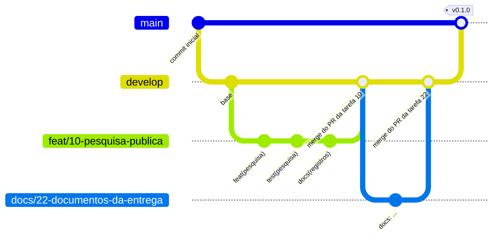
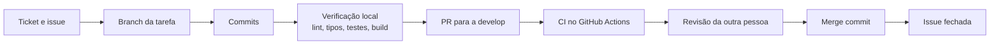

# Padrões de Git: branches, commits e pull requests

Como o time versiona o código nos dois repositórios do Sistema de Satisfação Hospitalar: a estrutura de branches, o padrão das mensagens de commit, o fluxo dos pull requests e como as tarefas e a contribuição de cada pessoa ficam registradas. As regras valem para a API (este repositório) e para o front ([`fhdod-satisfacao-web`](https://github.com/GabrielPittaBr/fhdod-satisfacao-web)). O dia a dia está no [`AGENTS.md`](../AGENTS.md) de cada um.

## 1. Os dois repositórios

| Repositório | Contém | Entrega |
| --- | --- | --- |
| [`fhdod-satisfacao-api`](https://github.com/GabrielPittaBr/fhdod-satisfacao-api) | API, banco (Prisma e migrations), testes, infraestrutura de produção e a documentação do sistema (`docs/`) | Imagem Docker da API e o `openapi.json` |
| [`fhdod-satisfacao-web`](https://github.com/GabrielPittaBr/fhdod-satisfacao-web) | Front em React, telas e o `Caddyfile` | Imagem Docker do front |

O que liga os dois é o **contrato da API**, o `openapi.json`, versionado na API. Uma funcionalidade que mexe nos dois lados vira **dois pull requests ligados**: primeiro o da API, com o `openapi.json` regenerado (`pnpm openapi:exportar`); depois o do front, com os tipos regenerados (`pnpm api:tipos`). No deploy, a API sobe antes do front.

## 2. Branches

O modelo é um **GitFlow simplificado**: uma branch de integração, uma de versões estáveis e uma branch curta por tarefa.



| Branch | Para quê | Quem escreve nela |
| --- | --- | --- |
| `main` | Só versões estáveis, prontas para o hospital, cada uma com tag (`v0.1.0`, `v0.2.0`...) | Só o merge da `develop` |
| `develop` | Integração: reúne o que já passou pelo PR | Só o merge das branches de tarefa, por PR |
| `<tipo>/<NN>-<assunto>` | Uma tarefa (um ticket) | Quem pegou o ticket |

- **Ninguém commita direto na `develop` nem na `main`.**
- **Nome da branch:** o tipo do commit, o número do ticket com dois dígitos e um resumo em kebab-case, sem acentos. Exemplos reais: `feat/05-login-sessao-e-acesso`, `feat/21-pesquisa-geral`, `chore/02-node-26`, `docs/20-readme-e-homologacao` (API); `ci/02-ci-e-verificacao-de-commits`, `feat/13-revisao-de-ux-e-acessibilidade` (front). Uma exceção no histórico: `docs/readme-visual`, no front, sem número de ticket.
- **A branch nasce da `develop` atualizada:**

```powershell
git switch develop; git pull; git switch -c feat/05-login-sessao-e-acesso
```

- **Situação em 26/11/2026:** a `main` dos dois repositórios ainda só tem o commit inicial. A primeira versão estável vai para a `main`, com tag, depois de aprovada na homologação com o hospital (ticket 20).

## 3. Commits

O padrão é o [Conventional Commits](https://www.conventionalcommits.org/pt-br/): `tipo(escopo): descrição`.

| Parte | Regra |
| --- | --- |
| Tipo | Em inglês: `feat`, `fix`, `docs`, `chore`, `style`, `refactor`, `test` ou `ci` |
| Escopo | O módulo, com o nome da pasta: `src/modules/` na API (`pesquisa`, `dashboard`...) e `src/features/` no front. Fora dos módulos, a área (`prisma`, `middlewares`, `tickets`, `registros`, `infra`); sem escopo quando toca o projeto inteiro |
| Descrição | Em português, curta, começando com minúscula e sem ponto final |
| Corpo | Opcional; explica o porquê quando ele não é óbvio, com linhas de até 100 caracteres |
| Assinatura | **Nenhuma.** Sem `Co-Authored-By` de agente e sem "Generated with" de ferramenta de IA |

**Exemplos reais do histórico:**

```text
feat(pesquisa): pesquisa geral com a escolha dos setores
test(tv-wall): acesso, token da tela, último acesso, períodos e nenhum dado pessoal
refactor(dashboard): contas pelos setores pedidos, sem quem está logado
test(prisma): dados de demonstração, rodar de novo, senhas e a confirmação do comando
docs(registros): pesquisa geral e ticket 21 concluído
chore: cobertura dos testes com o pnpm test:cobertura
```

**Como é garantido:** o Husky roda o commitlint ([`commitlint.config.js`](../commitlint.config.js)) em cada commit. Ele recusa um tipo fora da lista, uma linha longa demais e qualquer coautoria ou assinatura de ferramenta de IA (a regra `sem-coautoria-do-claude`). O [`tests/commitlint.test.ts`](../tests/commitlint.test.ts) testa a própria configuração.

Na `develop` da API, em 26/11/2026: 55 commits `feat`, 48 `docs`, 19 `test`, 10 `chore`, 6 `refactor` e 1 `ci`. No front: 35 `feat`, 32 `docs`, 10 `chore`, 6 `refactor`, 5 `fix`, 1 `test`, 1 `style` e 1 `ci`.

## 4. Pull requests



1. **Um PR por ticket, sempre para a `develop`.** O padrão do GitHub é a `main`, então a base é conferida na hora de abrir: `gh pr create --base develop`.
2. **Descrição pelo modelo** ([`.github/pull_request_template.md`](../.github/pull_request_template.md)): "O que mudou", "Como testar", "O que mudou em relação ao plano" e "Ticket". Mudanças de tela levam print.
3. **CI obrigatório** ([`.github/workflows/ci.yml`](../.github/workflows/ci.yml)): `pnpm lint`, `pnpm typecheck`, `pnpm test` (na API, com um PostgreSQL 18 no próprio Actions), a conferência do `openapi.json` (só na API) e `pnpm build`. Os mesmos comandos rodam na máquina antes de abrir o PR.
4. **Revisão:** a outra pessoa do time lê o PR e aprova pelo "Review changes" do GitHub. Checklist de quem revisa:
   - a rota nova valida com Zod e está no Swagger;
   - a permissão e o escopo de setor estão testados (401, 403, nenhuma lista com dado de outro setor);
   - a tela funciona no celular e no computador;
   - o `openapi.json` (ou os tipos do front) acompanham a mudança de contrato;
   - o registro da entrega está escrito e os critérios do ticket, marcados.
5. **Merge commit, sem squash**, para o histórico da `develop` mostrar cada PR e manter os commits de cada pessoa.
6. **Issue fechada à mão** depois do merge (`gh issue close NN --comment "Entrou na develop pelo PR #NN."`): o GitHub só fecha sozinho quando o PR entra na branch padrão, que é a `main`.

**Situação real da revisão:** até 26/11/2026, os 37 PRs mergeados (24 na API e 13 no front) foram mergeados sem aprovação registrada no GitHub. A regra do time sempre foi a aprovação da outra pessoa (plano, "Fluxo Git"). A partir deste ticket, a revisão é feita e registrada pelo "Review changes" antes do merge. Para o GitHub exigir isso sozinho, a `develop` pode ganhar uma regra de proteção com uma aprovação e o CI verde.

## 5. Tarefas: tickets, issues e Kanban

- **Cada tarefa é um ticket** em `docs/tickets/NN-assunto.md`, espelhado como **issue** no GitHub. O ticket diz o que construir, por quem está bloqueado, o status e os critérios de aceite. Hoje são 22 na API e 13 no front.
- **Só se pega um ticket com os bloqueios feitos.** Tickets `ready-for-human` precisam de alguém do time (servidor, domínio, conversa com o hospital).

| Status | No arquivo | No GitHub |
| --- | --- | --- |
| `ready-for-agent` | `**Status:** ready-for-agent` | Etiqueta `ready-for-agent` |
| `ready-for-human` | `**Status:** ready-for-human` | Etiqueta `ready-for-human` |
| `in-progress` | `**Status:** in-progress` | Etiqueta `in-progress` |
| `done` | `**Status:** done`, critérios marcados | Issue fechada |

- **Quadro Kanban:** as issues dos dois repositórios num quadro do GitHub Projects, com as colunas A fazer, Em andamento, Em revisão e Feito. Link: **pendente**. O endereço do quadro entra aqui e no README quando estiver publicado.

## 6. Registro do processo

Cada entrega ganha um arquivo em `docs/registros/AAAA-MM-DD-NN-assunto.md`, com:

- o que foi feito;
- as decisões e o porquê de cada uma;
- as ferramentas usadas;
- como foi verificado;
- o que mudou em relação ao plano;
- as pendências.

São 23 registros na API e 15 no front, de 10/11 a 26/11/2026. Junto com os tickets e os PRs, eles contam a história do projeto do começo ao fim.

## 7. Contribuição de cada pessoa

A autoria aparece em três lugares: o **autor de cada commit**, o **autor de cada PR** e quem **revisou** cada PR. Cada pessoa commita com a própria conta, e os PRs não usam squash, então os commits de cada um continuam no histórico da `develop`.

**Na `develop`, em 26/11/2026, sem contar os commits de merge:**

| Pessoa | Nomes de autor no Git | Commits na API | Commits no front | PRs mergeados (API + front) | Principais entregas |
| --- | --- | --- | --- | --- | --- |
| Gabriel Fernandes Pitta | `GabrielPittaBr`, `Gabriel Fernandes Pitta` | 136 | 80 | 23 + 11 | Fundação dos dois repositórios, CI, modelo de dados, login, cadastros, pesquisa por setor, dashboard, TV Wall, exportações, Docker e produção, dados de demonstração |
| Bernardo Finkler | `BeFinkler`, `Bernardo Finkler` | 4 | 12 | 1 + 2 | Pesquisa geral (`/avaliar`, API e front), revisão de UX e acessibilidade (menu de acessibilidade com o tamanho do texto e o VLibras, dashboard em seções, TV sem interação), ajuda no painel (PR #27 do front, aberto) e a documentação da entrega e a cobertura dos testes (ticket 22) |

Os números mudam a cada PR. Para gerar a tabela de novo, num dos repositórios:

```powershell
git fetch origin; git shortlog -sne --no-merges origin/develop
```

```powershell
gh pr list --state merged --limit 200 --json author --jq 'group_by(.author.login)[] | "\(.[0].author.login): \(length)"'
```

## 8. Verificação antes do commit

| Gancho | O que roda |
| --- | --- |
| `pre-commit` | lint-staged: ESLint e Prettier nos arquivos alterados (os `.md` ficam fora do Prettier, para as tabelas escritas à mão não serem realinhadas) |
| `commit-msg` | commitlint |

`.editorconfig` e `.nvmrc` deixam o editor e a versão do Node iguais para todos.

## 9. Definição de pronto

Uma tarefa só está pronta quando:

- [ ] `pnpm lint`, `pnpm typecheck`, `pnpm test` e `pnpm build` passam, na máquina e no CI;
- [ ] toda rota nova valida com Zod e está no Swagger;
- [ ] a permissão e o escopo de setor estão testados;
- [ ] o `openapi.json` foi regenerado e commitado se o contrato mudou (e os tipos do front, no PR do front);
- [ ] a entrega está registrada em `docs/registros/`;
- [ ] os critérios do ticket estão marcados e o status é `done`;
- [ ] a outra pessoa do time revisou e aprovou o PR.

## 10. Versões

1. A `develop` vai para a `main` nos dois repositórios, com o CI verde e uma tag de versão. Se o contrato mudou, a API vai primeiro.
2. O servidor atualiza os dois repositórios e sobe a versão com um comando, como no README, em "Produção e homologação".
