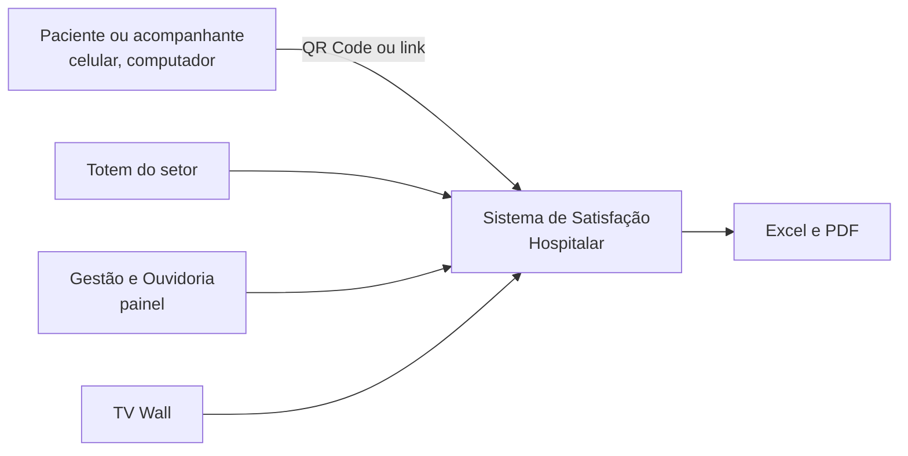

# Especificação de Requisitos — Sistema de Satisfação Hospitalar (FHDOD)

| Versão | Data | Autores | O que mudou |
| --- | --- | --- | --- |
| 1.0 | 26/11/2026 | Bernardo Finkler e Gabriel Fernandes Pitta | Primeira versão, reunindo o briefing do hospital, as regras do Plano de Desenvolvimento (29/10, revisado em 20/11 e 26/11) e o que o MVP entrega |

O documento segue a estrutura da IEEE 830 (introdução, descrição geral e requisitos específicos). Os requisitos não funcionais estão organizados pelas características de qualidade da ISO/IEC 25010.

## 1. Introdução

### 1.1 Propósito

Descreve o que o sistema faz, para quem, com que qualidade e com quais limites. Serve ao hospital, para conferir que o pedido dele foi entendido; ao time, como referência do que está pronto e do que falta; e à banca, para ligar cada requisito ao código e ao teste que o comprovam.

### 1.2 Escopo do produto

O **Sistema de Satisfação Hospitalar** substitui a pesquisa em papel e o formulário do Google Forms da Ouvidoria. Pacientes e acompanhantes avaliam o atendimento pelo celular (QR Code ou link) ou pelo totem do setor. A gestão acompanha os indicadores num painel com níveis de acesso por setor, a Ouvidoria recebe os pedidos de retorno, uma TV mostra os números gerais e tudo pode ser exportado em Excel e PDF.

| Entra no MVP | Fica para depois | Fora do projeto |
| --- | --- | --- |
| Pesquisa por setor (celular, computador e totem) e pesquisa geral (`/avaliar`), com NPS obrigatório, comentário e telefone para retorno · Cadastros de setores, categorias, turnos, perguntas e usuários · Login com perfis e escopo por setor · Dashboard · Respostas e pedidos de retorno · TV Wall · Exportação em Excel e PDF | **Fase 2:** gestão da ouvidoria (status e responsável), alertas por e-mail, importação de escalas e vínculo com equipes, configurações pela tela, consulta da auditoria · **Fase 3:** atualização em tempo real (SSE), WhatsApp, taxa de adesão | Leitura da pulseira e dados de prontuário |

### 1.3 Definições e siglas

| Termo | Significado |
| --- | --- |
| NPS | *Net Promoter Score*: a nota de 0 a 10 para "De 0 a 10, qual a probabilidade de você recomendar o hospital a alguém?". O índice é o % de promotores menos o % de detratores, de −100 a +100 |
| Promotor, neutro, detrator | Quem deu 9–10, 7–8 e 0–6 no NPS |
| Avaliação (resposta) | Um envio da pesquisa para um setor: data do atendimento, turno, NPS e as perguntas respondidas |
| Classificação | `NORMAL`, `BAIXA` ou `BAIXISSIMA`: a pior entre o NPS e as notas de 1 a 5 da avaliação (RN-04) |
| Setor | Unidade com pesquisa própria (Pronto Atendimento, Raio-X...), com endereço e QR Code |
| Categoria | Etapa da jornada, comparável entre setores (Recepção, Triagem, Enfermagem, Médico...) |
| Turno | Período do dia (Manhã, Tarde, Noite) |
| Canal | Por onde a avaliação chegou: `WEB` ou `TOTEM` (e `WHATSAPP`, na fase 3) |
| Totem | Aparelho fixo de um setor, em modo quiosque |
| TV Wall | Tela com os indicadores gerais, para exibição pública |
| Complemento | Comentário e telefone enviados depois do NPS |
| Slug | Identificador do setor no endereço, como `pronto-atendimento` |
| Escopo de setor | Os setores que uma pessoa do painel enxerga |
| LGPD | Lei Geral de Proteção de Dados Pessoais (Lei 13.709/2018) |
| MVP | A primeira versão entregue, até 27/11/2026 |

### 1.4 Referências

- O briefing do hospital: a lista "Funcionalidades solicitadas pelo cliente" e as decisões pedidas à dupla.
- [Plano de Desenvolvimento](Plano%20de%20Desenvolvimento%20-%20FHDOD.md): regras de negócio, endpoints, telas e decisões.
- Personas e pesquisa de UX do projeto: Sônia (paciente), Camila (acompanhante) e Renata (Ouvidoria).
- [`openapi.json`](../openapi.json): o contrato da API.
- IEEE 830-1998 e ISO/IEC 25010.

### 1.5 Como ler este documento

A seção 2 descreve o produto e quem o usa; a 3, os requisitos, cada um com um identificador; a 4 liga cada pedido do briefing aos requisitos, ao código e aos testes; a 5 lista o que ainda depende de confirmação do hospital.

## 2. Descrição geral

### 2.1 Perspectiva do produto

A Ouvidoria fazia a pesquisa em papel: cerca de 3 respostas a cada 500 atendimentos, formulários incompletos e sem data, reclamações escritas no verso e nenhuma forma de saber o setor, o turno ou a equipe. Quem respondia era, em geral, quem estava insatisfeito, os elogios se perdiam e a equipe gastava horas transcrevendo o papel para planilhas. Depois, o hospital passou a divulgar um link do Google Forms.

O sistema é novo e independente: um front web e uma API com banco próprio, sem integração com outros sistemas do hospital.

### 2.2 Funções do produto

1. **Pesquisa:** por setor (pelo QR Code ou pelo totem) ou geral (a pessoa escolhe os setores); data e turno do atendimento; perguntas da jornada, todas opcionais; NPS obrigatório; comentário e telefone para retorno.
2. **Painel:** indicadores com filtros, NPS por setor, evolução, médias por categoria, ranking, comentários, lista de avaliações e pedidos de retorno.
3. **Cadastros:** setores com links e QR Codes, categorias, turnos, perguntas de cada setor, usuários e telas da TV.
4. **TV Wall:** indicadores gerais em tela cheia, sem dados pessoais.
5. **Exportação:** resumo em Excel e PDF; respostas detalhadas em Excel.

### 2.3 Usuários

| Usuário | Perfil no sistema | Persona | Familiaridade com tecnologia | Canal | O que precisa |
| --- | --- | --- | --- | --- | --- |
| Paciente | Público, sem login | Sônia, 68 anos | Básica | Totem ou tablet no hospital | Responder sem esforço, com botões grandes, sem se identificar |
| Acompanhante | Público, sem login | Camila, 33 anos | Alta | Celular, pelo QR Code ou link | Avaliar o dia certo do atendimento, elogiar e criticar |
| Ouvidoria | `OUVIDORIA` | Renata, 43 anos | Intermediária a alta | Painel no computador | Ver volume, manifestações e pedidos de retorno; exportar sem redigitar |
| Super Admin | `SUPER_ADMIN` | — | — | Painel | Cadastrar setores, usuários, telas da TV |
| Gestor de setor | `GESTOR` | — | — | Painel | Montar as perguntas e acompanhar os seus setores |
| Visualizador | `VISUALIZADOR` | — | — | Painel | Ver os indicadores dos seus setores |

### 2.4 Restrições

- **LGPD:** a pesquisa é anônima; o único dado pessoal é o telefone, opcional e com consentimento.
- **Arquitetura:** dois repositórios (API e front), por exigência da disciplina; API em Node.js, TypeScript e PostgreSQL; front em React.
- **Prazo:** MVP em quatro semanas, até 27/11/2026.
- **Hospedagem:** de preferência em data center no Brasil; tudo em Docker para rodar em qualquer servidor.
- **Aparelhos:** celulares e computadores do público, totens e TVs do hospital (modelos a confirmar, seção 5).

### 2.5 Suposições e dependências

Os valores que o sistema usa enquanto o hospital não confirma estão na seção 5. A publicação depende de um servidor e de um subdomínio do hospital (ticket 20).

### 2.6 Requisitos adiados

| Requisito | Fase | Por quê |
| --- | --- | --- |
| Status, responsável e histórico dos pedidos de retorno | 2 | O MVP registra os pedidos; o fluxo de atendimento depende da rotina da Ouvidoria |
| E-mail em nota baixíssima e recuperação de senha por e-mail | 2 | Precisa do servidor de e-mail do hospital; a classificação já é gravada desde o MVP |
| Importação das escalas e vínculo da avaliação com a equipe | 2 | Depende do modelo de planilha do hospital |
| Tela de configurações e consulta da auditoria | 2 | Os padrões atendem o MVP; a auditoria já é gravada |
| Atualização em tempo real (SSE) | 3 | A consulta a cada 60 s (painel) e 30 s (TV) atende indicadores que mudam devagar |
| Pesquisa pelo WhatsApp | 3 | A API já tem o campo `canal` e as regras nos services |
| Taxa de adesão | 3 | Precisa do número de atendimentos de cada mês |

## 3. Requisitos específicos

### 3.1 Interfaces externas

| Tipo | Descrição |
| --- | --- |
| Usuário | Quatro áreas num só front: pesquisa (`/s/:setor`, `/avaliar`), totem (`/totem/:setor`), TV (`/tv#<token>`) e painel (`/login`, `/painel/...`) |
| Software | API REST em `/api/v1`, JSON, documentada em OpenAPI (Swagger em `/api/docs`); erros sempre no formato `{ "erro": { codigo, mensagem, detalhes, requestId } }` |
| Hardware | Totem com tela de toque em modo quiosque; TV em tela cheia (1920 × 1080); celulares, tablets e computadores |
| Comunicação | HTTPS; front e API no mesmo domínio; sessão em cookie `HttpOnly`, `Secure` e `SameSite=Strict` |

### 3.2 Requisitos funcionais

**Prioridade:** E = essencial (o MVP não existe sem ele); D = desejável. **Origem:** item do briefing (`B-NN`, seção 4), levantamento posterior (`L-NN`) ou regra de negócio (`RN-NN`, seção 3.4). Os testes de integração ficam em `tests/integration/` da API; os do front, em `src/features/` do [front](https://github.com/GabrielPittaBr/fhdod-satisfacao-web).

#### Pesquisa do paciente

| ID | Requisito e critério de aceite | Prior. | Origem | Rota da API / tela | Teste |
| --- | --- | --- | --- | --- | --- |
| RF-PES-01 | Abrir a pesquisa de um setor pelo endereço. **Aceite:** `/s/<slug>` mostra o nome do setor, as perguntas ativas em ordem e os turnos; setor inexistente ou desativado dá 404, com a mensagem de pesquisa indisponível | E | B-01, RN-06 | `GET /publico/setores/:slug/pesquisa` · `/s/:setor` | `pesquisa.test.ts`; front `pesquisa/api.test.ts` |
| RF-PES-02 | Pesquisa geral, com a escolha de um ou mais setores. **Aceite:** `/avaliar` lista os setores ativos; a pessoa marca um ou mais e responde só as perguntas deles, um setor depois do outro; o envio grava uma avaliação por setor, numa transação | E | L-01, RN-07 | `GET /publico/pesquisa`, `POST /publico/respostas` · `/avaliar` | `pesquisa-geral.test.ts`; front `fluxo-geral.test.ts` |
| RF-PES-03 | Informar o dia e o turno do atendimento. **Aceite:** no celular, "Hoje", "Ontem" ou "Outra data" e o turno em botões; no totem, vale o dia de hoje e o turno do horário atual, sem perguntar | E | B-06, persona Camila | Tela de data e turno | Front `fluxo.test.ts` |
| RF-PES-04 | Responder as perguntas do setor, uma por tela, todas opcionais. **Aceite:** um toque responde e avança; "Pular" sempre visível; pergunta pulada não gera registro | E | B-03, B-04, RN-03 | Tela de pergunta | Front `fluxo.test.ts`; `pesquisa.test.ts` |
| RF-PES-05 | Dar a nota de 0 a 10 (NPS), a única obrigatória, e gravar a avaliação ao confirmá-la. **Aceite:** sem o NPS, a API recusa (400); com ele, grava e devolve a classificação | E | B-02, RN-01, RN-02 | `POST /publico/setores/:slug/respostas` | `pesquisa.test.ts` |
| RF-PES-06 | Não duplicar a avaliação. **Aceite:** a mesma chave de idempotência enviada de novo devolve a avaliação já gravada, sem criar outra | E | RN-08 | Mesma rota | `pesquisa.test.ts` |
| RF-PES-07 | Classificar a avaliação. **Aceite:** NPS até 6 ou nota de 1 a 5 até 3 é `BAIXA`; NPS até 2 ou nota 1 é `BAIXISSIMA`; a classificação é a pior entre o NPS e as notas | E | RN-04, RN-19 | Service da pesquisa | `src/shared/rules/classificar-nota.test.ts` |
| RF-PES-08 | Deixar um comentário depois do NPS. **Aceite:** "Quer contar o que aconteceu?" na avaliação baixa e "Quer deixar um elogio ou uma sugestão?" nas outras; tipos elogio, reclamação, sugestão ou outro; até 500 caracteres; vale só com o token do envio, uma vez, por 30 minutos | E | B-05 | `POST /publico/respostas/:id/complemento` | `complemento.test.ts` |
| RF-PES-09 | Pedir retorno do hospital. **Aceite:** telefone e consentimento explícito (desmarcado por padrão); na web, oferecido a todos; no totem, só na avaliação baixa; o telefone é gravado cifrado | E | B-05, RN-05 | Mesma rota | `complemento.test.ts`, `src/shared/rules/telefone.test.ts` |
| RF-PES-10 | Na pesquisa geral com vários setores, escolher o setor do comentário. **Aceite:** "Sobre qual setor?"; o comentário e o telefone vão para a avaliação desse setor | E | L-01, RN-07 | Complemento | `pesquisa-geral.test.ts`; front `fluxo-geral.test.ts` |
| RF-PES-11 | Modo totem. **Aceite:** depois do envio, volta ao início sozinho no tempo configurado (10 a 15 s); com 60 s sem toque no meio da pesquisa, pergunta "Ainda está aí?"; nada fica guardado no navegador | E | RN-09 | `/totem/:setor` | Front `fluxo.test.ts`; os tempos, a conferir no totem na homologação |
| RF-PES-12 | Mostrar o progresso sem dizer quantas perguntas faltam | D | RN-12 | Pesquisa | Inspeção da tela |
| RF-PES-13 | Recusar robôs. **Aceite:** um campo isca preenchido é recusado (400); mais de 30 envios em 15 min do mesmo IP recebem 429, menos o IP do hospital | E | Segurança | Rotas públicas | `pesquisa.test.ts`, `pesquisa-geral.test.ts` |

#### Acesso ao painel

| ID | Requisito e critério de aceite | Prior. | Origem | Rota da API / tela | Teste |
| --- | --- | --- | --- | --- | --- |
| RF-AUT-01 | Entrar com e-mail e senha. **Aceite:** senha certa abre o painel; e-mail ou senha errados, ou conta desativada, dão o mesmo 401, sem dizer qual dos dois errou; 5 erros em 15 min bloqueiam o login (429) | E | B-07 | `POST /auth/login` · `/login` | `auth.test.ts`; front `auth/api.test.ts` |
| RF-AUT-02 | Manter a sessão. **Aceite:** o token de acesso vale 15 min e é renovado uma vez sozinho; recarregar a página não pede a senha de novo por até 7 dias | E | Segurança | `POST /auth/refresh` | `auth.test.ts` |
| RF-AUT-03 | Sair. **Aceite:** o logout revoga a sessão e apaga o cookie | E | Segurança | `POST /auth/logout` | `auth.test.ts` |
| RF-AUT-04 | Saber quem está logado, com perfil, permissões e setores. **Aceite:** o menu mostra só o que o perfil pode usar | E | B-07 | `GET /auth/me` | `auth.test.ts`; front `menu.test.ts` |
| RF-AUT-05 | Trocar a própria senha, obrigatório no primeiro acesso. **Aceite:** mínimo de 10 caracteres, com letras e números; a troca encerra as outras sessões | E | Segurança | `PATCH /auth/senha` | `auth.test.ts`, `senha.test.ts` |

#### Cadastros

| ID | Requisito e critério de aceite | Prior. | Origem | Rota da API / tela | Teste |
| --- | --- | --- | --- | --- | --- |
| RF-SET-01 | Listar os setores visíveis à pessoa | E | B-01 | `GET /setores` · `/painel/setores` | `setores.test.ts` |
| RF-SET-02 | Criar e editar setores (Super Admin). **Aceite:** slug único (409 se repetido) | E | B-01 | `POST /setores`, `PATCH /setores/:id` | `setores.test.ts` |
| RF-SET-03 | Ativar e desativar um setor. **Aceite:** desativado, a pesquisa dele sai do ar e o histórico continua | E | Histórico | `PATCH /setores/:id/status` | `setores.test.ts` |
| RF-SET-04 | Mostrar os links e o QR Code de cada setor e do link geral, prontos para imprimir | E | B-01, L-01 | `/painel/setores` | Front `setores/api.test.ts` |
| RF-CAT-01 | Listar, criar, editar e desativar categorias (Super Admin). **Aceite:** nome único, sem diferença de maiúsculas | E | B-04 | `/categorias` · `/painel/cadastros` | `categorias.test.ts` |
| RF-TUR-01 | Listar, criar e editar turnos (Super Admin). **Aceite:** horários `HH:mm`; o da noite pode passar da meia-noite | E | B-06 | `/turnos` · `/painel/cadastros` | `turnos.test.ts` |
| RF-PER-01 | Criar e editar perguntas de um setor (Super Admin e Gestor do setor). **Aceite:** tipos escala de 1 a 5, sim ou não, múltipla escolha e texto; cada pergunta numa categoria; o tipo de uma pergunta já respondida não muda | E | B-04, RN-10 | `POST /setores/:setorId/perguntas`, `PATCH /perguntas/:id` · `/painel/setores/:id/perguntas` | `perguntas.test.ts` |
| RF-PER-02 | Ordenar as perguntas, na ordem da jornada | E | B-04 | `PUT /setores/:setorId/perguntas/ordem` | `perguntas.test.ts` |
| RF-PER-03 | Ativar e desativar perguntas. **Aceite:** desativada, sai da pesquisa e continua no histórico | E | Histórico | `PATCH /perguntas/:id/status` | `perguntas.test.ts` |
| RF-PER-04 | Avisar, sem bloquear, quando o setor passar de 8 perguntas ativas | D | Risco de abandono | Tela de perguntas | Inspeção da tela |
| RF-USU-01 | Criar usuários com senha provisória e editar nome e perfil (Super Admin). **Aceite:** e-mail único | E | B-07 | `POST /usuarios`, `PATCH /usuarios/:id` · `/painel/usuarios` | `usuarios.test.ts` |
| RF-USU-02 | Definir os setores de cada usuário | E | B-07 | `PUT /usuarios/:id/setores` | `usuarios.test.ts` |
| RF-USU-03 | Ativar e desativar usuários. **Aceite:** desativar revoga as sessões na hora | E | Segurança | `PATCH /usuarios/:id/status` | `usuarios.test.ts` |
| RF-USU-04 | Redefinir a senha de um usuário (nova senha provisória) | E | Senha esquecida no MVP | `POST /usuarios/:id/redefinir-senha` | `usuarios.test.ts` |

#### Painel e indicadores

| ID | Requisito e critério de aceite | Prior. | Origem | Rota da API / tela | Teste |
| --- | --- | --- | --- | --- | --- |
| RF-DSH-01 | Resumo: NPS, total de avaliações, promotores, neutros, detratores, média das notas e notas baixas | E | B-08 | `GET /dashboard/resumo` · `/painel` | `dashboard.test.ts`, `calcular-nps.test.ts` |
| RF-DSH-02 | NPS e volume de cada setor | E | B-08 | `GET /dashboard/nps-por-setor` | `dashboard.test.ts` |
| RF-DSH-03 | Evolução do NPS por dia, semana ou mês, com os períodos sem resposta | E | B-08 | `GET /dashboard/evolucao` | `dashboard.test.ts` |
| RF-DSH-04 | Média e % de notas 4 e 5 por categoria | E | B-04, B-08 | `GET /dashboard/categorias` | `dashboard.test.ts` |
| RF-DSH-05 | Ranking dos melhores e piores pontos (setor × categoria) | E | B-08 | `GET /dashboard/ranking` | `dashboard.test.ts`, `ranking-de-pontos.test.ts` |
| RF-DSH-06 | Comentários recentes, por tipo | E | B-05 | `GET /dashboard/comentarios` | `dashboard.test.ts` |
| RF-DSH-07 | Filtrar por período, base da data (atendimento ou envio), setor, turno e canal. **Aceite:** os filtros ficam na URL, e a exportação sai com os mesmos filtros | E | B-08 | Todas as rotas do painel | `dashboard.test.ts`; front `filtros.test.ts` |
| RF-DSH-08 | Atualizar os números sozinho a cada 60 s | E | B-08 | `/painel` | Inspeção do código (`refetchInterval`) |
| RF-RES-01 | Listar as avaliações com filtros (classificação, com comentário, com pedido de retorno), ordem e páginas | E | Ouvidoria | `GET /respostas` · `/painel/respostas` | `respostas.test.ts` |
| RF-RES-02 | Ver o detalhe de uma avaliação, com as perguntas que a pessoa leu e o telefone mascarado | E | Ouvidoria | `GET /respostas/:id` | `respostas.test.ts` |
| RF-CON-01 | Listar os pedidos de retorno (Super Admin e Ouvidoria) | E | B-05 | `GET /contatos` · `/painel/contatos` | `contatos.test.ts` |
| RF-CON-02 | Revelar o telefone completo de um pedido. **Aceite:** só com `contatos:ver`, e cada revelação vai para a auditoria | E | B-05, LGPD | `POST /contatos/:id/revelar-telefone` | `contatos.test.ts` |

#### TV Wall

| ID | Requisito e critério de aceite | Prior. | Origem | Rota da API / tela | Teste |
| --- | --- | --- | --- | --- | --- |
| RF-TV-01 | Cadastrar telas da TV (Super Admin). **Aceite:** o link com o token aparece uma única vez, ao criar | E | B-09 | `POST /tv-telas`, `GET /tv-telas` · `/painel/tv` | `tv-wall.test.ts` |
| RF-TV-02 | Desativar uma tela. **Aceite:** o link para de funcionar na hora | E | B-09 | `PATCH /tv-telas/:id/status` | `tv-wall.test.ts` |
| RF-TV-03 | Mostrar os indicadores gerais em tela cheia, legíveis de longe, alternando as visões sozinha. **Aceite:** nenhum comentário, reclamação ou dado pessoal; o endpoint nem devolve esses campos | E | B-09, RN-15 | `GET /tv/indicadores` · `/tv#<token>` | `tv-wall.test.ts`; front `tv-wall/visoes.test.ts` |
| RF-TV-04 | Atualizar a cada 30 s e, se a rede cair, manter os últimos números com a hora da última atualização | E | B-09 | `/tv` | Front `tv-wall/api.test.ts`; a queda de rede, a conferir na homologação |

#### Exportação e auditoria

| ID | Requisito e critério de aceite | Prior. | Origem | Rota da API / tela | Teste |
| --- | --- | --- | --- | --- | --- |
| RF-EXP-01 | Exportar o resumo dos indicadores em Excel, com os filtros aplicados | E | B-10 | `GET /exportacoes/resumo.xlsx` | `exportacao.test.ts` |
| RF-EXP-02 | Exportar as avaliações detalhadas em Excel (avaliações, itens e comentários). **Aceite:** telefones só para quem tem `contatos:ver` | E | B-10 | `GET /exportacoes/respostas.xlsx` | `exportacao.test.ts` |
| RF-EXP-03 | Exportar o resumo em PDF | D | RN-14 | `GET /exportacoes/resumo.pdf` | `exportacao-pdf.test.ts` |
| RF-AUD-01 | Registrar ações sensíveis: login, troca e redefinição de senha, mudanças em usuários e perguntas, exportações e telefones revelados | E | Segurança, LGPD | `src/database/auditoria.ts` | `auth.test.ts`, `usuarios.test.ts`, `perguntas.test.ts`, `contatos.test.ts`, `exportacao.test.ts` |

#### Acessibilidade e ajuda

| ID | Requisito e critério de aceite | Prior. | Origem | Onde | Teste |
| --- | --- | --- | --- | --- | --- |
| RF-ACE-01 | Ajustar o tamanho do texto e ligar o VLibras pelo menu de acessibilidade | D | Persona Sônia | Front | Front `stores/acessibilidade.test.ts`, `lib/vlibras.test.ts` |
| RF-AJU-01 | Ajuda em cada tela do painel e o passo a passo para colocar a TV no ar | D | Ouvidoria | Front | Front `ajuda/secoes.test.ts` (em revisão, no PR #27 do front) |

### 3.3 Requisitos não funcionais (ISO/IEC 25010)

| ID | Característica | Requisito | Como se verifica |
| --- | --- | --- | --- |
| RNF-ADE-01 | Adequação funcional | Todo pedido do briefing tem requisito, implementação e teste, ou está registrado como adiado com o motivo | Matriz da seção 4 |
| RNF-DES-01 | Eficiência de desempenho | Quem abre a pesquisa não baixa o código do painel nem dos gráficos: cada área é carregada só quando acessada | `lazy()` em `src/app/router.tsx` do front |
| RNF-DES-02 | Eficiência de desempenho | Os indicadores são contados no banco, numa consulta por indicador, com índices nos filtros do painel | [`mapeamento-classes-e-consultas.md`](mapeamento-classes-e-consultas.md) |
| RNF-DES-03 | Eficiência de desempenho | A exportação lê as avaliações em lotes de 500, sem a memória crescer com o período | `exportacao.service.ts`, `exportacao.test.ts` |
| RNF-COM-01 | Compatibilidade | A mesma interface atende celular, tablet, computador, totem e TV | Teste nos aparelhos (homologação, ticket 20) |
| RNF-COM-02 | Compatibilidade | Front e API conversam por um contrato OpenAPI versionado; uma mudança que quebre o contrato impede a compilação do front | `tests/contrato.test.ts`; `pnpm api:tipos` no front |
| RNF-USA-01 | Usabilidade | Botões de pelo menos 48 px; texto da pesquisa de pelo menos 18 px | Inspeção da tela |
| RNF-USA-02 | Usabilidade | Contraste no nível AA da WCAG; a nota nunca depende só da cor (cada rostinho tem texto, de "Muito ruim" a "Muito bom") | Verificação de contraste; inspeção |
| RNF-USA-03 | Usabilidade | Uma pergunta por tela, "Pular" sempre visível, sem login para o paciente | Front `fluxo.test.ts` |
| RNF-USA-04 | Usabilidade | Navegação por teclado e rótulos para leitor de tela | Componentes Radix (shadcn/ui); inspeção |
| RNF-CON-01 | Confiabilidade | Envio idempotente: rede instável ou clique duplo não duplicam a avaliação | `pesquisa.test.ts` |
| RNF-CON-02 | Confiabilidade | `GET /api/health` responde se a API e o banco estão no ar | `health.test.ts` |
| RNF-CON-03 | Confiabilidade | Backup diário do banco às 3h, com 7 cópias diárias e 4 semanais e uma cópia fora do servidor | `infra/backup/`, `tests/producao.test.ts` |
| RNF-CON-04 | Confiabilidade | A TV mantém os últimos números se a rede cair | Homologação |
| RNF-SEG-01 | Segurança | Senhas com argon2id; nunca gravadas nem registradas em log | `password.test.ts` |
| RNF-SEG-02 | Segurança | Token de acesso de 15 min; refresh de 7 dias, trocado a cada uso, em cookie `HttpOnly`, `Secure` e `SameSite=Strict`, revogável | `auth.test.ts`, `tokens.test.ts` |
| RNF-SEG-03 | Segurança | Login limitado a 5 erros em 15 min por IP e e-mail; pesquisa limitada a 30 envios em 15 min por IP | `auth.test.ts`, `pesquisa.test.ts` |
| RNF-SEG-04 | Segurança | Permissão e escopo de setor conferidos no backend em toda rota; listagens nunca devolvem outro setor | `permissoes.test.ts` e os testes de cada módulo |
| RNF-SEG-05 | Segurança | Telefone cifrado com AES-256-GCM, mascarado nas telas, revelado só com permissão e sempre auditado | `crypto.test.ts`, `contatos.test.ts` |
| RNF-SEG-06 | Segurança | Toda entrada validada (Zod); SQL sempre parametrizado | `middlewares.test.ts`, `injecao.test.ts` |
| RNF-SEG-07 | Segurança | Logs em JSON sem senha, token, cookie nem telefone | `src/config/logger.ts`, `middlewares.test.ts` |
| RNF-SEG-08 | Segurança | HTTPS em produção; cabeçalhos de segurança (`helmet`) | Infra; `middlewares.test.ts` |
| RNF-MAN-01 | Manutenibilidade | Código em camadas (rotas, controller, service, repository), TypeScript `strict`, lint e formatação automáticos | CI |
| RNF-MAN-02 | Manutenibilidade | Testes automatizados nos dois repositórios, rodando no CI em todo PR; cobertura da API acima de 90% das instruções | [`plano-e-relatorio-de-testes.md`](plano-e-relatorio-de-testes.md) |
| RNF-POR-01 | Portabilidade | A aplicação roda em Docker, com a mesma configuração numa VPS, no servidor do hospital ou numa plataforma gerenciada | `infra/docker-compose.prod.yml`, `tests/producao.test.ts` |
| RNF-POR-02 | Portabilidade | As variáveis de ambiente são validadas ao iniciar; sem uma delas, a API não sobe | `src/config/env.test.ts` |
| RNF-PRI-01 | Segurança (privacidade) | A pesquisa não pede nome, documento nem prontuário, e o IP do paciente não é gravado | Modelo de dados |

A ISO/IEC 25010 ganhou uma revisão em 2023, que renomeia algumas características (por exemplo, "usabilidade" passa a "capacidade de interação"). Os requisitos acima continuam os mesmos em qualquer uma das versões.

### 3.4 Regras de negócio

| ID | Regra | Decisão |
| --- | --- | --- |
| RN-01 | Pergunta obrigatória | NPS de 0 a 10; não é uma pergunta editável pelos gestores |
| RN-02 | Ordem | A pesquisa fecha com o NPS; a avaliação é gravada ao confirmá-lo, e o comentário e o telefone chegam depois, como complemento |
| RN-03 | Demais perguntas | Todas podem ser puladas; pergunta pulada não gera registro |
| RN-04 | Notas baixas | Escala de 1 a 5: 3 ou menos é baixa, 1 é baixíssima. NPS: 0 a 6 é baixa, 0 a 2 é baixíssima. Os limites ficam no banco e são ajustáveis |
| RN-05 | Retorno ao paciente | Telefone opcional, com consentimento: na web, oferecido a todos no fim; no totem, só na avaliação baixa |
| RN-06 | Setor | Definido pelo endereço (`/s/:setor`, `/totem/:setor`), cada setor com o seu totem |
| RN-07 | Vários setores | Na pesquisa geral, uma nota de 0 a 10 vale para todos os setores escolhidos; uma avaliação por setor, cada uma classificada pelas notas do próprio setor; comentário e telefone vão para o setor que a pessoa indicar |
| RN-08 | Envio repetido | A mesma chave de idempotência devolve a avaliação já gravada |
| RN-09 | Totem | Reinicia sozinho de 10 a 15 s depois do envio, limpando tudo |
| RN-10 | Cadastros | O Super Admin cria setores; os gestores criam e editam as perguntas dos seus setores |
| RN-11 | Dispositivos | Celular, computador, tablet e totem; a mesma tela atende todos |
| RN-12 | Progresso | Barra discreta, sem mostrar quantas perguntas existem |
| RN-13 | E-mail | Gestor, Ouvidoria e Super Admin recebem e-mail em nota baixíssima (fase 2) |
| RN-14 | Exportação | Excel (principal) e PDF, gerados no backend, com filtros e permissões |
| RN-15 | TV Wall | Só avaliações gerais, sem comentários nem reclamações |
| RN-16 | WhatsApp | A API fica preparada (fase 3) |
| RN-17 | Pulseira | Fora do projeto |
| RN-18 | Configurações | `nps_limite_baixa` 6, `nps_limite_baixissima` 2, `escala_limite_baixa` 3, `escala_limite_baixissima` 1, `totem_reinicio_segundos` 15, `totem_inatividade_segundos` 60, `texto_limite_caracteres` 500 e o texto do NPS |
| RN-19 | Classificação | A classificação da avaliação é a pior entre o NPS e as notas de 1 a 5, calculada só pela API |

### 3.5 Requisitos de dados

As entidades, os atributos, as chaves e as restrições estão em [`modelo-de-dados-e-requisitos.md`](modelo-de-dados-e-requisitos.md).

### 3.6 Privacidade e LGPD

- Coleta mínima: a pesquisa é anônima; o único dado pessoal é o telefone, opcional e com consentimento explícito.
- O telefone é cifrado no banco, mascarado nas telas e revelado só com permissão, sempre com registro na auditoria.
- Nenhum dado pessoal vai para os logs, para a TV ou para as exportações de quem não tem permissão.
- O texto da pesquisa evita prometer anonimato absoluto ("Você pode responder sem informar nome ou telefone"), porque um comentário livre pode identificar alguém.
- O prazo de retenção das respostas e dos telefones depende do hospital (seção 5).

## 4. Rastreabilidade do briefing

### 4.1 Funcionalidades pedidas pelo hospital

| Briefing | Pedido do hospital | Regras | Requisitos | Implementação | Situação | Observação |
| --- | --- | --- | --- | --- | --- | --- |
| B-01 | Pesquisa por setor, cada um com endereço e QR Code próprios | RN-06 | RF-PES-01, RF-SET-01..04 | `/s/:setor`, `/totem/:setor`; QR Code em Setores | ✅ MVP | |
| B-02 | Apenas uma pergunta obrigatória (a classificação geral); as demais opcionais | RN-01, RN-02, RN-03 | RF-PES-04, RF-PES-05 | `respostas.nps` obrigatório no banco | ✅ MVP | **Mudança registrada:** no levantamento de setembro, a classificação geral era de 1 a 5; o plano de 29/10 adotou o NPS de 0 a 10 como a única nota obrigatória, e as notas de 1 a 5 ficaram nas perguntas de cada etapa. A confirmação do hospital está na seção 5 |
| B-03 | Só toques: rostinhos, botões grandes, etapas curtas, no celular e no tablet | RN-11 | RF-PES-04, RNF-USA-01..03 | Escala de rostinhos com texto, uma pergunta por tela | ✅ MVP | |
| B-04 | Perguntas pela jornada do paciente (Recepção, Triagem, Enfermagem, Médico), exibidas só quando fizerem sentido | RN-03, RN-10 | RF-PER-01..03, RF-CAT-01, RF-DSH-04 | Categorias comuns e perguntas próprias de cada setor, na ordem da jornada | 🟡 MVP | "Quando fizer sentido" foi resolvido **por setor**: cada setor só tem as perguntas que se aplicam a ele. Não há pergunta condicional dentro do mesmo setor; o modelo comporta isso no futuro |
| B-05 | Espaço para elogio, reclamação ou sugestão, sem identificação ou com telefone para retorno da Ouvidoria | RN-05 | RF-PES-08..10, RF-CON-01..02 | Complemento depois do NPS; pedidos de retorno no painel | ✅ MVP | O elogio é convidado também nas avaliações boas |
| B-06 | Cruzar a avaliação com a escala mensal (setor + data + turno) para saber a equipe envolvida | — | RF-PES-03, RF-TUR-01 | Setor, dia e turno já gravados em cada avaliação | ⏳ Fase 2 | A importação das escalas e o vínculo com a equipe dependem do modelo de planilha do hospital. O cruzamento não atribui nota a um profissional sem evidência |
| B-07 | Perfis: Super Admin, Admin de Setor, Gestão, Ouvidoria e Visualizador | RN-10 | RF-AUT-01..05, RF-USU-01..04 | 4 perfis: `SUPER_ADMIN`, `GESTOR`, `OUVIDORIA`, `VISUALIZADOR` | 🟡 MVP | O plano definiu 4 perfis: as funções de "Admin de Setor" e de "Gestão" ficaram no `GESTOR`, que gerencia as perguntas e vê os indicadores e as avaliações dos seus setores. Permissões extras por usuário, para o que o perfil não cobrir, ficam para a fase 2 |
| B-08 | Dashboard em tempo real, do hospital ao setor, ao turno e à equipe | — | RF-DSH-01..08 | Painel com filtros por setor, turno, canal e período; atualização a cada 60 s | 🟡 MVP | "Tempo real" por consulta a cada 60 s (SSE na fase 3); o nível da equipe vem com as escalas (fase 2) |
| B-09 | TV Wall com indicadores para exibição em tela | RN-15 | RF-TV-01..04 | `/tv#<token>`, só números agregados | ✅ MVP | |
| B-10 | Exportação dos dados em Excel | RN-14 | RF-EXP-01..02 | Excel com abas (resumo, avaliações, itens, comentários) | ✅ MVP | O PDF do resumo (RF-EXP-03) foi além do pedido |
| L-01 | Substituir o link do Google Forms, em que a pessoa escolhia o setor (levantamento de 26/11) | RN-07 | RF-PES-02, RF-PES-10 | `/avaliar` | ✅ MVP | O telefone passou a ser oferecido a todos na web, como no Forms |

**Resumo:** dos 10 pedidos do briefing, 6 estão completos no MVP, 3 estão no MVP com uma adaptação registrada (B-04, B-07 e B-08) e 1 fica para a fase 2 (B-06), com o setor, o dia e o turno já gravados para o cruzamento.

### 4.2 Decisões de produto pedidas no briefing

| Pergunta do briefing | Decisão | Onde está |
| --- | --- | --- |
| A pergunta obrigatória é NPS (0 a 10) ou rostinhos (1 a 5)? No início ou no fim? | NPS, **no fim**: as perguntas da jornada vêm antes, e a avaliação é gravada ao confirmar o NPS. Os rostinhos ficam nas perguntas de cada etapa | RN-01, RN-02 |
| A partir de qual nota encaminhar à Ouvidoria? | NPS até 6 ou nota de 1 a 5 até 3 é avaliação baixa; NPS até 2 ou nota 1 é baixíssima. Os limites são ajustáveis | RN-04, RN-18 |
| Como estimular quem teve boa experiência a responder? | Convite neutro, pesquisa curta e só por toques, QR Code em cada setor e espaço para elogio também nas avaliações boas | RF-PES-08, RNF-USA-03 |
| Como vincular à equipe sem responsabilizar injustamente um profissional? | O MVP grava setor, dia e turno; o vínculo com a escala (fase 2) distingue profissional, equipe e "não vinculada", e a TV nunca mostra resultado individual | B-06, RN-15 |
| LGPD: que dados guardar, por quanto tempo, quem vê o telefone? | Só o telefone, opcional, cifrado; visto pela Ouvidoria e pelo Super Admin, com auditoria. Prazo de retenção a definir com o hospital | RNF-SEG-05, RNF-PRI-01, seção 5 |
| O que a TV pública pode mostrar? | Só números agregados: NPS, volume, NPS por setor, evolução e destaques positivos. Nada de comentários, reclamações ou dados pessoais | RF-TV-03, RN-15 |
| Totem, tablet ou celular: qual priorizar? | Os dois, com a mesma tela: o celular (QR Code) alcança quem responde depois, em casa; o totem alcança quem tem menos familiaridade com tecnologia | RN-06, RN-11 |

## 5. Validação com o hospital

O que ainda depende da confirmação do hospital, com o valor que o sistema usa até lá.

| Item | Valor provisório no sistema | Confirmação do hospital |
| --- | --- | --- |
| Turnos oficiais e horários | Manhã (07:00–13:00), Tarde (13:00–19:00), Noite (19:00–07:00) | Pendente |
| Texto final da pergunta do NPS | "De 0 a 10, qual a probabilidade de você recomendar o hospital a alguém?" | Pendente |
| NPS de 0 a 10 como a única nota obrigatória (B-02) | NPS | Pendente |
| Quem pode ver os telefones | Ouvidoria e Super Admin | Pendente |
| Prazo de retenção das respostas e dos telefones | Sem prazo (nada é apagado) | Pendente |
| Setores, perguntas e gestores do piloto | Dados de demonstração | Pendente |
| Domínio e hospedagem | Indefinidos (ticket 20) | Pendente |
| Modelo dos totens (sistema e navegador) e local das TVs | Indefinidos | Pendente |
| Perguntar se quem responde é paciente ou acompanhante | Não perguntado | Pendente |

Cada confirmação entra aqui com a data e quem confirmou, e o roteiro de aceite das funcionalidades acontece na homologação (ticket 20).
