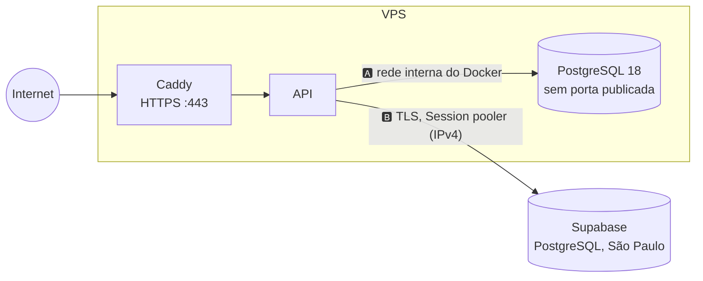

# Banco em nuvem e segurança dos dados

Onde o banco do Sistema de Satisfação Hospitalar roda, como a API se conecta a ele e como os dados ficam protegidos: controle de acesso, criptografia, restrição de rede, prevenção de injeção, backup e LGPD. O passo a passo da publicação está no [README](../README.md), em "Produção e homologação". As decisões vêm do [Plano de Desenvolvimento](Plano%20de%20Desenvolvimento%20-%20FHDOD.md) ("Segurança", "LGPD e dados pessoais", "Infraestrutura e deploy") e do registro [`2026-11-25-03-readme-e-homologacao.md`](registros/2026-11-25-03-readme-e-homologacao.md).

> [!IMPORTANT]
> **Situação em 26/11/2026:** os dois caminhos de hospedagem estão prontos e testados localmente, mas o banco **ainda não está no ar** na nuvem. A publicação é o [ticket 20](tickets/20-publicacao-em-homologacao.md), que depende do time (servidor, subdomínio e conversa com o hospital). As seções marcadas como **pendente** são preenchidas nele.

## 1. Onde o banco roda

| | 🅰️ Tudo na VPS | 🅱️ VPS e o banco no Supabase |
| --- | --- | --- |
| PostgreSQL | 18, num container da VPS, com os dados num volume | Gerenciado pelo Supabase, na região de São Paulo (`sa-east-1`) |
| Quem acessa o banco | Só a API, pela rede interna do Docker | A API, pelo pooler do Supabase, com TLS |
| Acesso remoto | Nenhuma porta aberta; para consultar, um túnel SSH até o servidor | Pela internet, com TLS, só dos IPs liberados |
| Backup | Diário, do próprio sistema (seção 7) | O do Supabase (diário só no plano Pro) |
| Compose | [`infra/docker-compose.prod.yml`](../infra/docker-compose.prod.yml) | O mesmo e o [`infra/docker-compose.banco-externo.yml`](../infra/docker-compose.banco-externo.yml) por cima |

Nos dois casos, a API e o front ficam numa VPS (Ubuntu 24.04, 2 vCPU, 4 GB de RAM, de preferência em data center no Brasil), atrás do Caddy com HTTPS.

**Recomendação:** para a homologação e a avaliação, o caminho 🅱️. Ele atende o "banco provisionado e acessível remotamente em um serviço de nuvem" do enunciado de Banco de Dados sem abrir portas na VPS, e a banca consegue se conectar a ele (seção 10). Para a produção, a escolha entre 🅰️ e o plano Pro do Supabase fica com o hospital, pelo custo e pelo backup.

**Provedor escolhido:** pendente (ticket 20).

## 2. Como a API se conecta



- A conexão vem toda do `DATABASE_URL`, validado ao iniciar ([`src/config/env.ts`](../src/config/env.ts)). No caminho 🅰️, o compose monta a URL com o `POSTGRES_PASSWORD`; no 🅱️, ela vem pronta do `infra/.env`.
- **No Supabase, o Session pooler**, e não a conexão direta: a direta é só IPv6, que os containers da VPS não alcançam. O pooler em modo de sessão aceita IPv4 e guarda a sessão inteira, o que as migrations precisam.
- **TLS com `sslmode=no-verify`:** a conexão é cifrada, mas o certificado não é conferido. O driver `pg` da API trata o `sslmode=require` como verificação completa, e o certificado do Supabase é de uma autoridade própria, que o Node não conhece: com o `require`, a API não conecta. Isso foi testado contra um PostgreSQL com SSL obrigatório e um certificado de autoridade própria (registro de 25/11). Para a produção no Supabase, o caminho é o `sslmode=verify-full` com o certificado do Supabase montado no container (`sslrootcert`), que também foi testado.
- Ao iniciar, a imagem da API roda o `prisma migrate deploy` e o seed base; se um dos dois falhar, a API não sobe.

## 3. Provisionamento

O passo a passo completo está no README, em "Passo a passo da homologação". No Supabase, o passo 4 tem os ajustes de segurança que este documento usa:

1. Projeto na região de São Paulo, com uma senha do banco forte.
2. **Data API desligado** (*Integrations › Data API*): a API do sistema fala direto com o PostgreSQL, e com o Data API ligado as tabelas do schema `public` poderiam ficar expostas pela API REST do Supabase.
3. **SSL obrigatório** (*Enforce SSL on incoming connections*).
4. **Network Restrictions** só com o IP do servidor (`IP-DO-SERVIDOR/32`).
5. A URL do Session pooler no `DATABASE_URL` do `infra/.env`, com `?sslmode=no-verify`.

**Evidências:** pendente (ticket 20). Quando o banco subir, entram aqui as telas do projeto (região, SSL, Data API e Network Restrictions), a saída do `prisma migrate deploy` e o `/api/health` respondendo `{"data":{"status":"ok","banco":"ok"}}`, sem nenhum segredo à mostra.

## 4. Controle de acesso

### 4.1 No banco: usuários e funções

| Conta | Quem usa | O que pode | Situação |
| --- | --- | --- | --- |
| Dona do banco (`app` no caminho 🅰️; `postgres` no Supabase) | A API: migrations ao iniciar e todas as consultas | Tudo no banco do sistema | Em uso |
| `banca_leitura` | A banca e relatórios externos | Só `SELECT`, sem as colunas de segredo, com validade | Script pronto: [`infra/banco/leitura-da-banca.sql`](../infra/banco/leitura-da-banca.sql) |

A conta `banca_leitura`:

- lê todas as tabelas, **menos as colunas de segredo**: `usuarios.senha_hash`, `respostas.token_complemento_hash` e `token_complemento_expira_em`, `contatos_retorno.telefone_cifrado` (fica o `telefone_final`), `tv_telas.token_hash` e a tabela `refresh_tokens` inteira;
- não grava: não tem permissão de escrita, e toda transação dela é só de leitura (`default_transaction_read_only`);
- deixa de entrar na data da validade (`VALID UNTIL`).

O script foi testado num PostgreSQL 18 local, em 26/11/2026: a conta leu as avaliações e o `telefone_final`, e foi recusada no `telefone_cifrado`, no `senha_hash`, nos `refresh_tokens` e em qualquer escrita, mesmo depois de desligar o modo só de leitura (`permission denied`).

**Próximo passo (não feito):** separar também a conta da API em duas, uma dona do banco, só para as migrations, e outra só com `SELECT`, `INSERT`, `UPDATE` e `DELETE`, para a API em execução. Isso pede mudar a imagem, que hoje aplica as migrations com a mesma conexão das consultas.

### 4.2 Na aplicação: perfis, permissões e escopo

Quem usa o painel nunca toca no banco: a API decide o que cada pessoa vê.

| Permissão | Super Admin | Gestor | Ouvidoria | Visualizador |
| --- | --- | --- | --- | --- |
| Cadastros (setores, usuários, categorias, turnos, telas da TV) | ✓ | | | |
| Perguntas | ✓ | ✓ nos seus setores | | |
| Dashboard e exportação do resumo | ✓ | ✓ nos seus setores | ✓ | ✓ nos seus setores |
| Avaliações, comentários e exportação detalhada | ✓ | ✓ nos seus setores | ✓ | |
| Telefones de retorno | ✓ | | ✓ | |

O escopo de setor vai **dentro da consulta**: para o Gestor e o Visualizador, toda lista leva `r.setor_id = ANY($setores)`, mesmo quando a pessoa pede "todos". O detalhe está em [`arquitetura-backend.md`](arquitetura-backend.md), seção 6.

## 5. Criptografia

| Dado | Como é protegido | Onde |
| --- | --- | --- |
| Conexão entre a API e o banco | TLS no Supabase; rede interna do Docker no caminho 🅰️ | `DATABASE_URL` |
| Conexão entre o usuário e o sistema | HTTPS, com certificado emitido e renovado pelo Caddy | Infra |
| Telefone de retorno | **AES-256-GCM**, com um IV sorteado a cada cifra, no formato `v1.<iv>.<etiqueta>.<cifrado>`; os 4 últimos dígitos ficam à parte, em claro, para a tela mostrar o número mascarado | [`src/shared/security/crypto.ts`](../src/shared/security/crypto.ts), com a `ENCRYPTION_KEY` (32 bytes) |
| Senhas | Hash **argon2id** (não se decifra; só se confere) | [`src/shared/security/password.ts`](../src/shared/security/password.ts) |
| Tokens (sessão, TV, complemento) | Só o hash **SHA-256** fica no banco; o token em si nunca é gravado | [`src/shared/security/tokens.ts`](../src/shared/security/tokens.ts) |
| Disco do banco | No Supabase, a criptografia em repouso do provedor; no caminho 🅰️, a do disco da VPS | Provedor |

A `ENCRYPTION_KEY` é guardada fora do servidor também, num cofre de senhas do time: sem ela, os telefones gravados (inclusive os das cópias de backup) não se leem mais.

## 6. Restrição de rede

| Medida | Caminho |
| --- | --- |
| O `postgres` não publica porta: só os containers da mesma rede o alcançam | 🅰️ |
| Firewall da VPS só com SSH, HTTP e HTTPS (22, 80 e 443) | 🅰️ e 🅱️ |
| Network Restrictions: o banco só aceita o IP do servidor | 🅱️ |
| SSL obrigatório: nenhuma conexão sem TLS | 🅱️ |
| Data API do Supabase desligado | 🅱️ |

O `RATE_LIMIT_ALLOWLIST` é outra coisa: é o IP do hospital, por onde saem os totens, fora do **limite de envios da pesquisa** da API.

## 7. Prevenção de injeção

- **Toda consulta é parametrizada.** O CRUD vai pela API do Prisma; os relatórios, por `$queryRaw` em template, que manda os valores separados do texto do SQL (`$1`, `$2`...). Nenhuma consulta é montada com texto vindo da requisição ([`mapeamento-classes-e-consultas.md`](mapeamento-classes-e-consultas.md), seção 6).
- **Toda entrada é validada antes**, com Zod: um `setorId` que não é número ou um `canal` fora da lista dão 400 antes de qualquer consulta.
- **Provado por teste:** [`tests/integration/injecao.test.ts`](../tests/integration/injecao.test.ts) manda SQL na senha e no e-mail do login, no endereço do setor, num comentário (`'); DROP TABLE respostas; --` com um `<script>`) e nos filtros do painel. O login recusa, o endereço vira um setor que não existe, o comentário é gravado e devolvido como texto (a tabela continua lá) e os filtros dão 400.
- **No front**, o React escapa o texto ao exibir: um comentário com HTML aparece como texto.

## 8. Backup e recuperação

| | 🅰️ Tudo na VPS | 🅱️ Supabase |
| --- | --- | --- |
| Quando | Todo dia às 3h (Brasília); se o servidor estava desligado, assim que volta | O do plano (diário só no Pro) |
| Como | `pg_dump` em formato custom, conferido com `pg_restore --list` | Do provedor |
| Retenção | 7 cópias diárias e 4 semanais | A do plano |
| Fora do servidor | Cópia para um remoto do rclone (`BACKUP_DESTINO`), com a mesma retenção | — |
| Restauração | `infra/backup/restaurar.sh`, num banco vazio, numa transação só; um teste por mês na homologação | Pelo painel do Supabase |
| Aviso de falha | O healthcheck do `backup` acusa falha ou backup com mais de 26 horas | — |

Os scripts ficam em [`infra/backup/`](../infra/backup/). No plano gratuito do Supabase, o projeto pausa depois de uma semana com pouca atividade e não guarda backups: serve para a homologação, não para a produção.

## 9. LGPD

- **Coleta mínima:** a pesquisa é anônima. O único dado pessoal é o telefone, opcional, com consentimento explícito e a hora do consentimento.
- **O IP do paciente nunca é gravado.** A auditoria guarda só o IP de quem usa o painel.
- **Logs sem dados pessoais:** senha, tokens, cookies e telefone viram `[oculto]` em qualquer nível do log.
- **Telefone revelado só com permissão**, e cada revelação vai para a auditoria.
- **TV e exportações** sem dados pessoais para quem não tem permissão.
- **Dados no Brasil:** VPS de preferência no Brasil; Supabase na região de São Paulo.
- **Retenção:** pendente. O prazo para guardar as avaliações e os telefones depende do hospital; na fase 2, uma rotina apaga os telefones vencidos.

## 10. Variáveis de ambiente e acesso da banca

### 10.1 Variáveis

Os modelos [`.env.example`](../.env.example) (desenvolvimento) e [`infra/.env.example`](../infra/.env.example) (servidor) trazem os nomes e exemplos falsos. O `.env` e o `infra/.env` **nunca vão para o Git** (`.gitignore`), e o `infra/.env` do servidor fica com `chmod 600`.

| Variável | Para quê | Segredo |
| --- | --- | --- |
| `DATABASE_URL` | Conexão com o banco | Sim |
| `POSTGRES_PASSWORD` | Senha do banco no caminho 🅰️ | Sim |
| `JWT_ACCESS_SECRET` | Assina o token de acesso | Sim |
| `ENCRYPTION_KEY` | Cifra os telefones (32 bytes em base64) | Sim |
| `SEED_ADMIN_EMAIL`, `SEED_ADMIN_PASSWORD` | O primeiro Super Admin; apagadas depois do primeiro acesso | Sim |
| `DEMO_PASSWORD_*` | Senhas das contas de demonstração, só na homologação | Sim |
| `DOMAIN`, `CORS_ORIGIN` | Endereço do sistema | Não |
| `RATE_LIMIT_ALLOWLIST` | IP do hospital fora do limite de envios | Não |
| `DOCS_ENABLED`, `LOG_LEVEL` | Swagger e nível de log | Não |
| `ACCESS_TOKEN_TTL`, `REFRESH_TOKEN_TTL_DAYS` | Validade das sessões | Não |
| `BACKUP_DESTINO` | Remoto da cópia de fora | Não |

### 10.2 Acesso para a banca

1. **Criar a conta só de leitura**, no banco da homologação, com uma senha forte e a validade logo depois da avaliação:

   ```powershell
   psql "<DATABASE_URL>" -v senha='<senha forte>' -v validade='<AAAA-MM-DD>' -f infra/banco/leitura-da-banca.sql
   ```

2. **Liberar o IP de quem avalia** nas Network Restrictions do Supabase, só durante a avaliação.
3. **Entregar a credencial por um canal privado**, nunca no repositório, no PDF da entrega ou numa issue: host do pooler, porta `5432`, banco `postgres`, usuário `banca_leitura.<referência do projeto>` (o formato de usuário do pooler do Supabase), senha e `sslmode=require`. Um cliente como o DBeaver, ou o `psql`:

   ```text
   postgresql://banca_leitura.<ref>:***@<host do pooler>:5432/postgres?sslmode=require
   ```

4. **Depois da avaliação:** tirar o IP das Network Restrictions e apagar a conta (`DROP OWNED BY banca_leitura; DROP ROLE banca_leitura;`), ou deixar a validade vencer.

**Credencial entregue:** pendente (ticket 20).

## 11. Checklist

- [x] Dois caminhos de hospedagem prontos, com o compose de produção e o do banco externo testados (registro de 25/11)
- [x] Conexão com TLS ao Supabase testada contra um PostgreSQL com SSL obrigatório
- [x] Senhas, tokens e telefones protegidos no banco
- [x] Consultas parametrizadas, com teste de entrada maliciosa
- [x] Conta só de leitura para a banca, com script testado
- [x] Backup diário com cópia fora do servidor e restauração (caminho 🅰️)
- [ ] Banco no ar na nuvem, com as evidências (ticket 20)
- [ ] SSL obrigatório, Network Restrictions e Data API desligado conferidos no painel (ticket 20)
- [ ] Credencial da banca entregue, com validade (ticket 20)
- [ ] Prazo de retenção definido com o hospital
